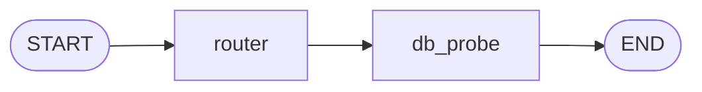
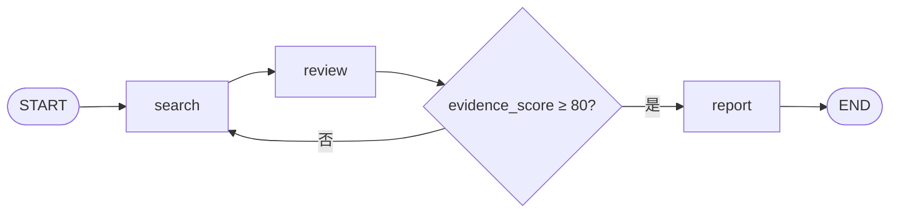

# LangGraph 学习笔记：与 LangChain 对照

记录日期：2026-10-19。以当前官方 Python 文档和本目录示例为起点，后续按实验逐章补充。

学习主线是 LangGraph 的概念、执行机制与实践。LangChain 用于概念对照，已有项目仅作可选案例补充；课程按知识点推进。

已补充：[第一课：State 更新与条件路由](./notes/01_State更新与条件路由.md)，配套运行文件为 `state_routing_demo.py`。

已补充：[第二课：Checkpointer 与 thread_id](./notes/02_Checkpointer与thread_id.md)，配套运行文件为 `checkpoint_demo.py`。

已补充：[第三课：中断与恢复](./notes/03_中断与恢复.md)，配套运行文件为 `interrupt_demo.py`。

已补充：[第四课：消息状态与 Agent 循环](./notes/04_消息状态与Agent循环.md)，配套运行文件为 `message_loop_demo.py`。

已补充：[第五课：并发与合并](./notes/05_并发与合并.md)，配套运行文件为 `parallel_merge_demo.py`。

可选案例：[已有 LangChain 项目的 Agent 循环对照](./notes/02_从你的LangChain项目理解Agent循环.md)，配套运行文件为 `aiops_agent_loop_demo.py`。

本次检查使用命令行默认 Python：3.13.7；已安装 `langgraph==1.2.4`、`langchain-core==1.4.6`，未安装 `langchain` 主包。PyCharm 使用的解释器可能不同。

## 1. 先明确三者的关系

**LangChain 提供模型、工具和标准 Agent 循环等抽象；LangGraph 提供状态与执行流程的底层编排；自研描述团队自己实现或定制了哪些部分。**

当前 LangChain 的 `create_agent` 底层使用 LangGraph。一个项目也可以直接使用 LangGraph，在节点中调用模型厂商 SDK，或复用 LangChain 的模型和工具组件。因此两者经常组合使用。[依据：LangChain overview](https://docs.langchain.com/oss/python/langchain/overview)、[LangGraph overview](https://docs.langchain.com/oss/python/langgraph/overview)

版本架构区别：经典的 `create_tool_calling_agent + AgentExecutor` 与这里的 `create_agent` 是不同入口；不能将当前入口的底层关系直接套用到经典执行器。

```text
业务应用：排障助手 / 研究助手 / 客服
    │
    ├─ 标准 Agent 循环 → LangChain create_agent → LangGraph 运行时
    │
    └─ 定制执行流程   → 直接定义 LangGraph 图
                           │
                           └─ 节点可调用 LangChain 组件、厂商 SDK 或普通 Python
```

这是常见组合方式，不代表每个应用都必须采用这些层。

| 对照点 | LangChain | 直接使用 LangGraph |
| --- | --- | --- |
| 主要入口 | `create_agent`、模型/工具接口、middleware | `StateGraph`、节点、边及状态更新 |
| 流程由谁组织 | 框架提供标准模型与工具调用循环，可扩展 | 开发者明确设计执行路径及状态转换 |
| 典型需求 | 给模型一组工具，按任务调用并回答 | 搜索、审核、回退、人工审批等定制步骤 |
| 状态与恢复 | Agent 可使用底层 LangGraph 能力，仍需相应配置 | 直接配置和控制这些能力 |
| 组合方式 | 一个 LangChain Agent 可以放入更大的流程 | 节点可以使用 LangChain Agent 或组件 |

不要将 LangChain 理解成“只能按顺序调用的旧式 Chain”。当前官方也将它定位为 Agent 框架。[依据：官方开源技术栈介绍](https://www.langchain.com/oss-overview)

## 2. “10% LangChain、40% LangGraph、50% 自研”可靠吗？

**目前没有找到能支持这组数字的可靠、口径明确的全市场统计，先将它记为待验证的观察。**

这组分类本身有重叠：

1. 使用当前 LangChain `create_agent` 的项目，也使用了 LangGraph 运行时。
2. 团队称系统为“自研 Agent”，可能只是业务逻辑、工具、记忆策略和权限控制自研，底层仍使用开源框架。
3. “市面上的 Agent”可能指商业产品、开源项目、企业内部应用，或开发者问卷，分母不同会得到不同结果。
4. 这三个名称没有单独覆盖其他框架；若把其他框架全部归入自研，也需要说明规则。

LangChain 的 State of Agent Engineering 报告明确提到有人基于 LangChain/LangGraph 构建定制 Agent，但没有给出上述三类的全市场份额。它的数据来自 2025-11-18 至 2025-12-02 的公开问卷，共 1,340 份回答；技术行业占 63%。这是特定受访样本，不足以直接代表所有 Agent 产品。[依据：报告正文与 Methodology](https://www.langchain.com/state-of-agent-engineering)

笔记中可以暂时这样表述：

> Agent 有多种构建方式，开源框架与团队自研经常结合。LangChain 和 LangGraph 处于不同抽象层，不能直接视为互斥的市场份额分类；具体占比需要注明调查来源、时间、样本和分类口径。

以后看到份额数据，优先核对：**统计谁、统计何时、能否多选、“自研”如何定义。** GitHub stars、下载量也不能直接换算为生产部署份额。

## 3. 从现有代码理解 Workflow 与 Agent

Workflow 的执行路径由程序预先规定，可以包含分支和循环；Agent 则会让模型根据任务动态选择行动或工具。实际系统可以混合两种方式。[依据：Workflows and agents](https://docs.langchain.com/oss/python/langgraph/workflows-agents)

### hello_graph.py：固定顺序



实际执行的是：收到报警 → 修改状态 → 返回模拟探测结果。

- `router` 目前只是节点名称，没有根据报警动态选择后续节点。
- `db_probe` 返回预设字符串，没有连接数据库。
- 代码没有调用大模型，适合用来学习图的基本执行过程。

### test.py：带条件分支的循环



按照当前代码，第一轮搜索后评分为 50，第二轮为 90，随后生成报告。搜索结果和评分都是模拟值。这是带循环的确定性工作流，可作为以后加入模型判断的骨架。

**有循环、有多个节点，并不自动构成自主 Agent 或多 Agent。** 判断时应看谁在决定行动，以及节点是否真的承担独立 Agent 职责。

## 4. 第一批核心概念

| 概念 | 在当前示例中的含义 |
| --- | --- |
| State | 本次流程的共享状态，如问题、搜索次数、证据评分 |
| Node | 处理函数，如 `search_node`，返回需要更新的字段 |
| Edge | 固定执行关系，如搜索之后执行审核 |
| Conditional edge | 根据路由函数的返回值选择下一节点 |
| Reducer | 定义同一字段如何合并更新；普通字段默认替换 |
| `compile()` | 将图定义转换成可执行对象，并进行结构检查 |
| `invoke()` | 执行图并取得最终结果 |

这里的 Graph 表示计算流程，可以有环；它与知识图谱是不同概念。[依据：Graph API](https://docs.langchain.com/oss/python/langgraph/graph-api)

例如 `router_node` 返回：

```python
return {"status": "analyzing"}
```

它只提交 `status` 的更新，其他字段保留原值。因此通常不必返回整个 State，也应避免依靠原地修改传入字典来传播更新。

`hello_graph.py` 中“全局共享的备忘录”适合作为入门比喻，但要记住：State 是图执行中的共享数据，并非所有用户共同读写的进程全局变量；节点也可以访问数据库、外部服务和运行时上下文。[依据：Graph API 的状态与节点说明](https://docs.langchain.com/oss/python/langgraph/graph-api)

## 5. State、Checkpoint、Memory 不要混淆

| 概念 | 解决的问题 |
| --- | --- |
| State | 当前流程处理到了哪里、已有何种数据 |
| Checkpointer | 按 thread 保存执行状态，支持继续、检查与恢复 |
| Store | 保存跨 thread 使用的数据，例如用户偏好与事实 |

当前两个示例都直接调用 `compile()`，没有配置 checkpointer；不能据此认为它们已经具备跨进程恢复能力。学习时可以先尝试 `InMemorySaver` 和 `thread_id`，但内存中的 checkpoint 在进程退出后会丢失；跨重启保存需要持久化后端。[依据：Persistence](https://docs.langchain.com/oss/python/langgraph/persistence)

“能恢复执行”也需要配合节点设计。以后节点涉及发消息、写库等副作用时，要考虑重执行和幂等，不能只依赖 checkpoint。[依据：Graph API 的 Re-execution and idempotency](https://docs.langchain.com/oss/python/langgraph/graph-api)

## 6. 为什么有人选择自研？

以下是工程上的取舍分析，不是对市场比例的推断：

- 流程很短时，普通 Python 函数与循环可能已经足够。
- 业务需要特定的调度、数据结构、权限或上下文管理方式。
- 团队已有任务队列、状态存储与监控，希望接入既有基础设施。
- 团队愿意承担执行引擎的维护成本，以获得更多控制。

自研一个“调用模型 → 调用工具 → 再调用模型”的循环很容易起步。难点通常随着需求增加而出现：状态恢复、重试、并发合并、人工暂停、日志追踪、成本限制和质量评估。选择框架，是在复用能力、理解抽象与长期维护之间做权衡。

学习 LangGraph 时，应同时理解它帮你处理了哪些执行问题。即使以后自研，这些概念仍然适用。

## 7. 后续学习顺序

| 阶段 | 动手内容 | 应能解释的问题 |
| --- | --- | --- |
| ① 图与状态 | 逐步运行现有两个文件 | 每一步读了什么、返回什么、下一步是谁？ |
| ② 合并规则 | 增加搜索历史字段，比较替换与累积 | 为什么一次更新会覆盖之前的内容？ |
| ③ 状态持久化 | 加入 checkpointer，比较相同/不同 `thread_id` | 多次执行怎样延续 State？ |
| ④ 中断与恢复 | 使用 interrupt 暂停，再恢复执行 | 暂停时保存了什么，哪些代码可能重跑？ |
| ⑤ 消息与 Agent 循环 | 连接模型节点和工具节点 | AIMessage、ToolMessage 如何驱动循环？ |
| ⑥ 并发合并 | 分支并行执行，再汇总 | super-step 是什么，冲突字段怎样合并？ |
| ⑦ 子图与执行设计 | 将一个流程封装为子图 | 状态如何跨边界传递，如何设计重试与退出？ |

每节采用同一笔记格式：**要解决的问题 → LangGraph 概念 → 最小可运行实验 → 实际输出 → 易错点**。在有助于理解时加入简短的 LangChain 对照或已有项目案例。

第一课已在 `state_routing_demo.py` 中实现：记录每一步的 State，并增加“达到搜索次数上限仍不合格”的退出路径。原有 `test.py` 的模拟逻辑保证第二次合格；改用真实模型评分后，需要显式设计停止条件。
