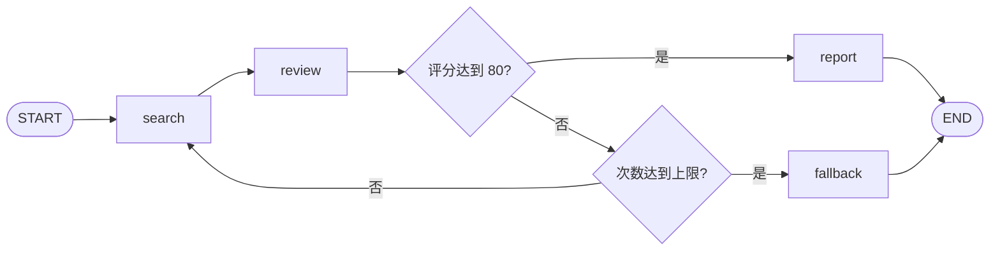

# LangGraph 入门第一课：用 State、Reducer 和条件边搭出可控循环

> 本文配套课程示例：`state_routing_demo.py`。示例里的搜索结果和评分都是模拟数据，不需要模型 API Key。

如果用普通 Python 写一个“搜索—审核—不合格就重试”的流程，我们可能会写一个 `for` 循环、一个历史列表，再用 `if` 判断是否退出。

LangGraph 做的事情，是把这类流程显式拆成三部分：**State 保存数据，Node 执行工作，Edge 决定下一步**。理解这三件事，就能读懂很多 LangGraph 工作流。

## LangChain、LangGraph 和自研代码各管什么？

可以先用下面这句话建立一个粗略地图：

> LangChain 提供模型、工具和标准 Agent 循环等抽象；LangGraph 提供状态与执行流程的编排；自研代码承载团队自己的业务规则和定制能力。

这几部分并不是互斥选项。当前 `langchain.agents.create_agent` 使用 LangGraph 的图运行机制；也可以直接编写 LangGraph 图，并在节点里调用 LangChain 组件、模型厂商 SDK 或普通 Python 函数。需要特别区分的是，经典的 `AgentExecutor` 与当前 `create_agent` 是不同 API，不能把一个的实现结论直接套到另一个上。

“有多少项目用了 LangChain、LangGraph 或自研”也不能只凭这三个名字给出一个可靠百分比：实际项目常常把框架和自研业务逻辑组合起来，分类口径会重叠。

## 一个研究流程的目标

假设我们要回答“为什么销售额下降？”。流程每轮搜索一条模拟结果，再给证据打分：

- 分数达到 80，就生成报告；
- 分数不够且还有搜索额度，就再搜一轮；
- 搜索次数用完仍不够，就明确返回“证据不足”。

流程图可以画成这样：



## 1. State：节点之间传递的数据

State 是图执行时共享的数据结构。节点从 State 读取当前信息，然后返回自己要更新的字段。

```python
from operator import add
from typing import Annotated, Literal
from typing_extensions import TypedDict

from langgraph.graph import END, START, StateGraph


class ResearchState(TypedDict):
    question: str
    search_count: int
    max_searches: int
    mock_scores: list[int]
    search_result: str
    search_history: Annotated[list[str], add]
    evidence_score: int
    stage: str
    status: str
    report: str
```

`stage`、`status` 是我们为示例定义的普通业务字段，不是 LangGraph 的保留关键字。`TypedDict` 用于描述字典的字段和类型，本身不会替我们创建默认值或在运行时验证数据，所以示例会在入口处显式准备初始 State。

## 2. Node：只返回本轮更新

搜索节点读取已有搜索次数，计算新结果，并返回它负责更新的字段：

```python
def search_node(state: ResearchState):
    count = state["search_count"] + 1
    result = f"第 {count} 轮搜索结果"
    return {
        "search_count": count,
        "search_result": result,
        "search_history": [result],
        "stage": "search",
    }
```

节点不必把整个 State 再返回一遍。这里没有更新 `question`、`max_searches` 等字段，它们会保留已有值。把节点写成“读取输入、返回更新”的风格，也比在函数里原地修改 `state` 更容易理解和调试。

审核节点从预设分数中取一项：

```python
def review_node(state: ResearchState):
    index = min(state["search_count"] - 1, len(state["mock_scores"]) - 1)
    return {
        "evidence_score": state["mock_scores"][index],
        "stage": "review",
    }


def report_node(state: ResearchState):
    return {
        "report": f"问题：{state['question']}；模拟证据合格，可以生成报告。",
        "status": "completed",
        "stage": "report",
    }


def fallback_node(state: ResearchState):
    return {
        "report": f"已搜索 {state['search_count']} 次，证据仍不足，需要补充信息。",
        "status": "insufficient_evidence",
        "stage": "fallback",
    }
```

正式应用里可以把模拟审核替换成模型调用、规则引擎或数据库查询；对 LangGraph 来说，它们都只是节点里的处理逻辑。

## 3. Reducer：定义字段如何合并

示例特意放了两个搜索结果字段：

- `search_result` 没有 Reducer，每次更新都用新值替换旧值，因此只保留最近一轮。
- `search_history` 使用 `Annotated[list[str], add]`，每次把新列表和旧列表相加，因此会累积历史。

假设现有历史是 `["第 1 轮搜索结果"]`，搜索节点返回 `["第 2 轮搜索结果"]`，合并结果就是两条记录。

要注意，配置了 `add` 的字段应返回**本轮新增项**。如果把旧历史也一并返回，旧内容就会再加一次；返回空列表也不会清空历史，因为“旧列表 + 空列表”仍然是旧列表。确实需要清空时，应使用 LangGraph 提供的 `Overwrite` 机制，而不是依赖空列表。

对对话消息也不要简单套用 `operator.add`。`add_messages` 除了追加新消息，还能按消息 ID 更新已有消息；这是 `MessagesState` 常用的合并方式。

## 4. 条件边：把业务判断连到执行路径

路由函数只判断业务含义：

```python
def route_after_review(
    state: ResearchState,
) -> Literal["enough", "retry", "exhausted"]:
    if state["evidence_score"] >= 80:
        return "enough"
    if state["search_count"] >= state["max_searches"]:
        return "exhausted"
    return "retry"
```

建图时再把业务标签映射到节点名称：

```python
builder = StateGraph(ResearchState)
builder.add_node("search", search_node)
builder.add_node("review", review_node)
builder.add_node("report", report_node)
builder.add_node("fallback", fallback_node)

builder.add_edge(START, "search")
builder.add_edge("search", "review")
builder.add_conditional_edges(
    "review",
    route_after_review,
    {
        "enough": "report",
        "retry": "search",
        "exhausted": "fallback",
    },
)
builder.add_edge("report", END)
builder.add_edge("fallback", END)

graph = builder.compile()
```

这里 `"enough"` 是路由标签，`"report"` 才是图里的节点名。把判断和节点映射分开，之后想在重试前插入 `rewrite_query` 节点，只需要调整映射关系。

评分判断要放在搜索上限判断之前。否则最后一轮刚好达到 80 分时，可能被误判为“次数已用完”。另外，审核节点已经配置了条件边，就不要再额外加一条固定的 `review → search` 边，否则可能同时安排两条后续路径。

## 5. 观察一轮轮 State 的变化

示例用 `stream_mode="values"` 输出每一步合并后的完整 State：

```python
initial_state = {
    "question": "为什么销售额下降？",
    "search_count": 0,
    "max_searches": 3,
    "mock_scores": [50, 90],
    "search_result": "",
    "search_history": [],
    "evidence_score": 0,
    "stage": "input",
    "status": "running",
    "report": "",
}

for state in graph.stream(initial_state, stream_mode="values"):
    print(
        state["stage"],
        state["search_count"],
        state["evidence_score"],
        state["search_history"],
    )
```

核心过程大致是：

```text
input   | 搜索次数 0 | 评分 0  | 历史 0 条
search  | 搜索次数 1 | 评分 0  | 历史 1 条
review  | 搜索次数 1 | 评分 50 | 历史 1 条
search  | 搜索次数 2 | 评分 50 | 历史 2 条
review  | 搜索次数 2 | 评分 90 | 历史 2 条
report  | 搜索次数 2 | 评分 90 | 历史 2 条
```

第二次搜索后，`evidence_score` 仍是 50，因为搜索节点没有修改评分字段；新的 90 分要等审核节点运行后才写入。这提醒我们：State 是各字段共同组成的当前状态，但每个字段可能在不同节点更新。

## 业务退出条件和引擎步数限制不是一回事

`max_searches` 是业务规则：证据不足时最多再搜几轮。`recursion_limit` 是图执行的额外步数保护，限制图的 super-step 数量。串行流程里每轮搜索和审核都会消耗执行步数，所以不能把 `recursion_limit` 当作搜索次数上限，也不应依靠它来正常返回“证据不足”。

## 本课小结

可以用三句话记住这一课：

1. State 放流程需要共享的数据，节点返回本轮要更新的字段。
2. Reducer 决定同一字段的新旧值如何合并；默认覆盖，历史字段可以配置累积。
3. 条件边根据当前 State 选择下一步，业务退出条件应在图里明确表达。

示例完整代码：`state_routing_demo.py`。下一课继续研究：一张图执行结束后，如何用 Checkpointer 和 `thread_id` 延续之前的状态？

## 参考资料

- [LangGraph Graph API：State、Node、Edge 与 Reducer](https://docs.langchain.com/oss/python/langgraph/graph-api)
- [LangGraph Graph API：Conditional Edges](https://docs.langchain.com/oss/python/langgraph/graph-api#conditional-edges)
- [LangChain Agents](https://docs.langchain.com/oss/python/langchain/agents)

**建议标签：** LangGraph、LangChain、Python、AI Agent
