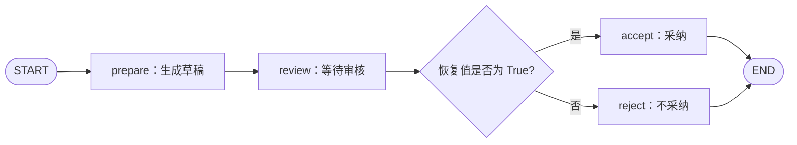

# LangGraph 入门第三课：用 interrupt 暂停流程，再用 Command 恢复

> 本文配套课程示例：`interrupt_demo.py`。审批过程使用本地模拟，不会调用模型或外部服务。

前两课分别讨论了图内状态如何更新，以及怎样用 Checkpointer 和 `thread_id` 保存状态。这一课继续解决另一个实际问题：流程执行到一半需要人确认时，怎样先暂停，等拿到输入后再接着执行？

LangGraph 用 `interrupt()` 表示动态暂停点，用 `Command(resume=...)` 把外部输入交回暂停处。中断不是条件边：中断负责等待输入，条件边负责在节点完成后选择下一步。

## 本课的审核流程



流程先生成草稿，再在 `review` 节点暂停。调用方展示暂停信息并收集审批结果，然后把布尔值作为恢复输入传回来。

## `interrupt()` 暂停，`Command` 恢复

先看状态和节点：

```python
from typing import Literal
from typing_extensions import TypedDict

from langgraph.checkpoint.memory import InMemorySaver
from langgraph.graph import END, START, StateGraph
from langgraph.types import Command, interrupt


class ReviewState(TypedDict):
    topic: str
    draft: str
    approved: bool
    status: str
    result: str


def prepare_node(state: ReviewState):
    print("[prepare] 生成草稿")
    return {
        "draft": f"关于{state['topic']}的学习摘要",
        "status": "draft_ready",
    }


def review_node(state: ReviewState):
    print("[review] 从节点开头执行，即将到达 interrupt")
    approved = interrupt({
        "question": "是否采纳这份草稿？请传入布尔值。",
        "draft": state["draft"],
    })
    if type(approved) is not bool:
        raise ValueError("恢复值必须是布尔值 True 或 False")
    return {"approved": approved, "status": "reviewed"}


def route_after_review(state: ReviewState) -> Literal["accept", "reject"]:
    return "accept" if state["approved"] else "reject"
```

`interrupt()` 的载荷需要能序列化为 JSON。首次运行到这个调用时，LangGraph 会把中断信息交回调用方，并等待恢复输入；恢复值会成为 `interrupt()` 的返回值。

要使用动态中断，图需要配置 Checkpointer，调用时也要提供 `thread_id`。下面是建图和调用方的关键部分：

```python
def accept_node(state: ReviewState):
    return {"status": "accepted", "result": state["draft"]}


def reject_node(state: ReviewState):
    return {"status": "rejected", "result": "草稿未采纳，需要修改。"}


def build_graph():
    builder = StateGraph(ReviewState)
    builder.add_node("prepare", prepare_node)
    builder.add_node("review", review_node)
    builder.add_node("accept", accept_node)
    builder.add_node("reject", reject_node)
    builder.add_edge(START, "prepare")
    builder.add_edge("prepare", "review")
    builder.add_conditional_edges("review", route_after_review)
    builder.add_edge("accept", END)
    builder.add_edge("reject", END)
    return builder.compile(checkpointer=InMemorySaver())


graph = build_graph()
config = {"configurable": {"thread_id": "review-001"}}

paused = graph.invoke({
    "topic": "LangGraph 中断与恢复",
    "draft": "",
    "approved": False,
    "status": "new",
    "result": "",
}, config)

print("中断载荷：", paused["__interrupt__"][0].value)
print("暂停时 State：", graph.get_state(config).values)
print("待继续节点：", graph.get_state(config).next)

result = graph.invoke(Command(resume=True), config)
print("最终状态：", result["status"])
```

`__interrupt__` 是默认 `invoke()` 返回值中的中断信息，不是我们定义的 State 字段。应用的网页或终端需要自行展示载荷、收集输入，再用同一份 Checkpointer 和同一个 `thread_id` 发起恢复调用。框架不会自动创建审批弹窗。

本例使用 `InMemorySaver`，所以只适合演示当前进程中的暂停与恢复。若要在服务重启后继续处理，需要换成可持久化的 Checkpointer，并确保恢复请求仍能访问原来的 checkpoint。

## 恢复时，为什么节点开头又执行了一次？

运行示例会看到：

```text
[prepare] 生成草稿
[review] 从节点开头执行，即将到达 interrupt
中断载荷：...

[review] 从节点开头执行，即将到达 interrupt
[accept] 采纳草稿（模拟）
```

恢复时，`review_node` 会从函数开头重新执行。它再次到达相同的 `interrupt()` 调用后，LangGraph 才把恢复值 `True` 作为该调用的返回值，让函数继续往下走。Python 不会把当时的局部变量和调用栈保存起来，再从那一行原地续跑。

本例中 `prepare` 已经完成并作为之前的执行结果保存，所以恢复时不会重跑 `prepare`；再次打印的是 `review` 节点开头的日志。

## 中断载荷、恢复值和 State 更新是三件事

| 数据 | 方向 | 例子 | 是否自动改 State |
| --- | --- | --- | --- |
| `interrupt(payload)` | 节点 → 调用方 | 待审核草稿和问题 | 否 |
| `Command(resume=value)` | 调用方 → 节点 | `True` 或 `False` | 否 |
| 节点返回的字典 | 节点 → State | `{"approved": True}` | 是，节点完成后提交 |

暂停时，`approved=False` 只是初始输入值，并不表示用户已经拒绝；此时 `status` 仍为 `draft_ready`。只有恢复后节点返回新的字段更新，流程才进入 `reviewed`，再由条件边路由到 `accept` 或 `reject`。

示例检查 `type(approved) is bool`。字符串 `"False"` 在 Python 中仍是非空字符串、条件判断结果为真，所以恢复载荷应采用明确的数据类型，而不是依赖真假值转换。

## 中断点前的副作用要小心

由于恢复时节点从头执行，`interrupt()` 之前的代码也会再次执行。假如这段代码发送邮件、扣款、插入数据库记录或调用计费 API，恢复时就可能重复产生副作用。

实用的设计方式是：

- 把耗时准备工作放到前一个已完成的节点，例如本例的 `prepare`。
- 让 `interrupt()` 尽量靠近需要等待输入的位置；它前面只放不会造成重复后果的读取或格式化操作。
- 对外部写操作设计幂等键、去重或 upsert。节点也可能因重试或故障恢复再次执行，不能仅靠“它在 interrupt 后面”来保证恰好执行一次。

不要吞掉或改写 LangGraph 的中断控制信号。让 `interrupt()` 正常向外暂停，由图运行时负责保存和恢复。

## 本课小结

1. `interrupt()` 在节点内部暂停，并把载荷交给调用方。
2. `Command(resume=value)` 在同一 thread 恢复；`value` 成为 `interrupt()` 的返回值。
3. 恢复时会重跑中断所在节点的开头，因此暂停前的副作用必须考虑重复执行。
4. 恢复值不会自动写入 State；需要由节点返回相应字段更新。

示例完整代码：`interrupt_demo.py`。下一课将把 State 中的普通业务字段与消息列表结合起来，观察模型请求、工具结果和条件路由怎样组成 Agent 循环。

## 参考资料

- [LangGraph Interrupts](https://docs.langchain.com/oss/python/langgraph/interrupts)
- [LangGraph Checkpointers：StateSnapshot](https://docs.langchain.com/oss/python/langgraph/checkpointers)
- [LangGraph Graph API：重执行与幂等性](https://docs.langchain.com/oss/python/langgraph/graph-api#re-execution-and-idempotency)

**建议标签：** LangGraph、Python、AI Agent、人机协同
