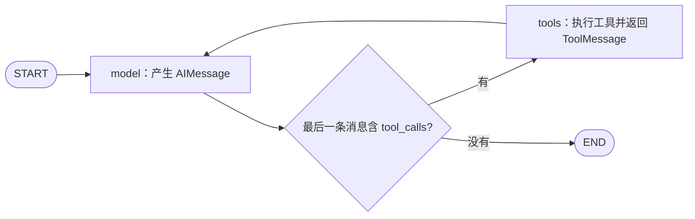

# LangGraph 入门第四课：用 MessagesState 串起模型请求与工具执行

> 本文配套课程示例：`message_loop_demo.py`。工具函数会真实执行加法和乘法；“模型决策”由固定 Python 规则模拟，不调用大模型，也不解析自然语言。

前三课学习了状态更新、条件路由、Checkpoint 和中断。这一课把重点放在消息上：用户消息如何进入 State，模型怎样提出工具请求，工具结果又如何回到下一轮模型调用？

本文不展开完整的 ReAct 提示词与推理策略，主要拆解 LangGraph 中一条常见的“模型 → 工具 → 模型”执行循环。

## 先看控制流程



三部分职责各不相同：模型节点提出结构化工具请求，`ToolNode` 执行已注册的工具，`tools_condition` 决定回到工具节点还是结束。

## `messages` 是 State 的一个字段

本课的状态继承 `MessagesState`，再补充计算参数和模型调用计数：

```python
from langgraph.graph import MessagesState


class CalculatorState(MessagesState):
    left: int
    right: int
    multiplier: int | None
    model_steps: int
```

`MessagesState` 自带 `messages` 字段，并使用 `add_messages` 作为 Reducer。节点只需要返回本轮新增的消息，图会按消息 Reducer 规则合并：

```python
return {"messages": [reply], "model_steps": step}
```

状态里有消息，并不意味着真实模型自动看到了这些内容。真实模型节点需要显式把 `state["messages"]` 传给模型；本课的模拟节点则用 Python 规则直接检查最新一条消息。

## 一条工具调用包含请求和结果两阶段

本课注册两个工具：

```python
from langchain_core.tools import tool


@tool
def add(a: int, b: int) -> int:
    """返回两个整数的和。"""
    return a + b


@tool
def multiply(a: int, b: int) -> int:
    """返回两个整数的积。"""
    return a * b


TOOLS = [add, multiply]
```

一个带工具调用的 `AIMessage` 大致长这样：

```python
AIMessage(
    content="",
    tool_calls=[{
        "name": "add",
        "args": {"a": 2, "b": 3},
        "id": "call_1",
        "type": "tool_call",
    }],
)
```

即使 `content` 是空字符串，这条 AI 消息仍然有内容：`tool_calls` 里放着工具名、参数和调用 ID。它只是一个结构化请求，尚未执行加法。`ToolNode` 执行 `add(2, 3)` 后，产生带有相同请求关联 ID 的 `ToolMessage`，内容为 `5`。

| 消息 | 产生方 | 作用 |
| --- | --- | --- |
| `HumanMessage` | 用户输入 | 提交问题 |
| 带 `tool_calls` 的 `AIMessage` | 模型节点 | 请求调用工具 |
| `ToolMessage` | 工具节点 | 返回工具执行结果 |
| 不带工具请求的 `AIMessage` | 模型节点 | 给出普通回答 |

`AIMessage.tool_calls[0].id` 与 `ToolMessage.tool_call_id` 配对，说明工具结果对应哪一次请求。

## 模拟模型节点怎样决定下一步

课程代码没有连真实模型，而是按最后一条消息模拟模型的决策：

```python
from langchain_core.messages import AIMessage, HumanMessage, ToolMessage


def scripted_model_node(state: CalculatorState):
    last = state["messages"][-1]
    step = state["model_steps"] + 1

    if isinstance(last, HumanMessage):
        reply = AIMessage(content="", tool_calls=[{
            "name": "add",
            "args": {"a": state["left"], "b": state["right"]},
            "id": f"call_{step}",
            "type": "tool_call",
        }])
    elif isinstance(last, ToolMessage):
        if last.name == "add" and state["multiplier"] is not None:
            reply = AIMessage(content="", tool_calls=[{
                "name": "multiply",
                "args": {
                    "a": int(last.content),
                    "b": state["multiplier"],
                },
                "id": f"call_{step}",
                "type": "tool_call",
            }])
        else:
            reply = AIMessage(content=f"结果是 {last.content}。")
    else:
        raise ValueError("本演示的决策输入应为用户消息或工具结果")

    return {"messages": [reply], "model_steps": step}
```

输入用户消息时，脚本请求加法；得到加法结果后，如果还提供了 `multiplier`，脚本再请求乘法；否则直接给出文本回答。这只是为了稳定展示协议。它没有理解“请计算”这句话，也不具备真实模型的工具选择能力。

## `ToolNode` 和条件边把循环接起来

```python
from langgraph.graph import END, START, StateGraph
from langgraph.prebuilt import ToolNode, tools_condition


def build_graph():
    builder = StateGraph(CalculatorState)
    builder.add_node("model", scripted_model_node)
    builder.add_node("tools", ToolNode(TOOLS))
    builder.add_edge(START, "model")
    builder.add_conditional_edges(
        "model",
        tools_condition,
        {"tools": "tools", "__end__": END},
    )
    builder.add_edge("tools", "model")
    return builder.compile()
```

`tools_condition` 检查最后一条 AI 消息：有工具请求就转到 `tools`，否则走向结束。工具执行完成后，`ToolMessage` 写回消息列表，固定边 `tools → model` 再启动下一轮。

在这段示例中，图没有配置 Checkpointer，因此消息只参与本次图执行，不会自动跨 `invoke()` 调用保存。若要跨调用延续，需要结合 Checkpointer 和 `thread_id`，这正是第二课介绍的机制。

## `add_messages` 和普通列表追加有什么区别？

普通 `operator.add` 只负责列表拼接。`add_messages` 除了追加新消息，还会比较消息自身的 ID：相同 ID 的新消息会更新已有消息；不同 ID 的消息则会作为新消息加入。

```python
from langchain_core.messages import AIMessage, HumanMessage
from langgraph.graph.message import add_messages

original = [HumanMessage(content="最初的问题", id="user-1")]
corrected = add_messages(
    original,
    [HumanMessage(content="修改后的问题", id="user-1")],
)
extended = add_messages(
    corrected,
    [AIMessage(content="收到。", id="assistant-1")],
)
```

`corrected` 中仍只有一条 HumanMessage，但内容已更新；`extended` 再多一条 AIMessage。这对人工修改已有对话消息等场景很有用。

注意这里存在两种不同的 ID：消息的 `message.id` 用于 `add_messages` 判断是否更新消息；工具请求的 `tool_call.id` 则通过 `ToolMessage.tool_call_id` 与工具结果对应。名字相似，职责不同。

## 运行示例会看到什么？

从项目根目录运行：

```powershell
python -X utf8 message_loop_demo.py
```

对表达式 `(2 + 3) * 4`，消息流程是：

| 次序 | 消息 | 内容 |
| --- | --- | --- |
| 1 | `HumanMessage` | 用户提出计算问题 |
| 2 | `AIMessage` | 请求 `add(2, 3)` |
| 3 | `ToolMessage` | `add` 返回 `5` |
| 4 | `AIMessage` | 请求 `multiply(5, 4)` |
| 5 | `ToolMessage` | `multiply` 返回 `20` |
| 6 | `AIMessage` | 回答“结果是 20。” |

对应结果为：模型模拟节点运行 3 次，工具执行 2 次，消息总数为 6。只计算 `2 + 3` 时则是模型模拟节点运行 2 次、工具执行 1 次、消息总数为 4。

## 接入真实模型时，替换决策节点

接入真实聊天模型时，可以将工具绑定到模型，并让节点把 State 中的消息送入模型：

```python
model_with_tools = model.bind_tools(TOOLS)


def model_node(state: CalculatorState):
    reply = model_with_tools.invoke(state["messages"])
    return {
        "messages": [reply],
        "model_steps": state["model_steps"] + 1,
    }
```

`bind_tools()` 把工具描述提供给模型，使模型可以返回工具调用请求；真正执行仍由图中的 `ToolNode` 完成。这个划分也说明，模型“提出请求”和程序“执行工具”是两个独立步骤。

## `RunnableWithMessageHistory` 和图状态是同一个东西吗？

不是。`RunnableWithMessageHistory` 包装一个 Runnable，并为它读取、更新对话历史；LangGraph 的 `MessagesState` 是图 State 中的消息字段，配合 Checkpointer 时保存的是整张图的执行状态。两种方案工作在不同抽象层，可以根据应用结构选择。

当前 Python 官方参考仍将 `RunnableWithMessageHistory` 列为一个管理 Runnable 对话历史的 API，页面没有将它标记为 Legacy 或 deprecated，因此不宜笼统说 Python 版本已经废弃或移除。另一方面，LangChain 的 `create_agent` 短期记忆是通过 Agent State 和 Checkpointer 管理的。对直接构建 LangGraph 图的场景，`MessagesState + Checkpointer` 能让消息历史与节点执行进度一起保存；对已有 Runnable/LCEL 链，历史包装器仍是另一种可用接口。

| 方案 | 主要工作对象 | 常见场景 |
| --- | --- | --- |
| `RunnableWithMessageHistory` | 包装的 Runnable 与会话消息历史 | 给一个 Runnable/LCEL 链接入会话历史 |
| `MessagesState + Checkpointer` | 图 State、消息字段和执行 checkpoint | LangGraph 图或基于 LangGraph 的 Agent 需要跨调用状态 |

Checkpointer 可以保存图的状态和执行进度，但“模型下一轮实际看到什么”仍由模型节点传入的消息决定；长对话还需要考虑裁剪、摘要或上下文窗口管理。

## 本课小结

- `MessagesState` 将对话消息作为图 State 的一部分，并用 `add_messages` 合并消息更新。
- 带 `tool_calls` 的 AIMessage 是结构化请求；`ToolNode` 执行工具后返回 ToolMessage。
- 条件边根据工具调用决定循环还是结束；工具节点之后通常回到模型节点。
- 本课用固定 Python 规则模拟决策，只验证消息协议和图控制流程，不代表真实 LLM 行为。
- `RunnableWithMessageHistory` 与 `MessagesState + Checkpointer` 处于不同抽象层，不应简单描述为旧方案与新方案的替代关系。

示例完整代码：`message_loop_demo.py`。下一课继续观察多个分支并发时如何向 State 写入，以及 Reducer 如何处理合并。

## 参考资料

- [LangGraph Quickstart：工具调用 Agent](https://docs.langchain.com/oss/python/langgraph/quickstart)
- [LangGraph Graph API：MessagesState 与 add_messages](https://docs.langchain.com/oss/python/langgraph/graph-api#messagesstate)
- [LangChain Short-term memory](https://docs.langchain.com/oss/python/langchain/short-term-memory)
- [Python API Reference：RunnableWithMessageHistory](https://reference.langchain.com/python/langchain-core/runnables/history/RunnableWithMessageHistory)

**建议标签：** LangGraph、LangChain、Python、AI Agent
