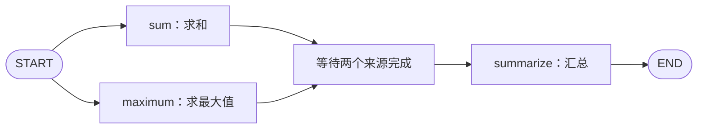

# LangGraph 入门第五课：并发分支、同步汇总与 State 合并

> 本文配套课程示例：`parallel_merge_demo.py`。程序对 `[2, 3, 5]` 求和、求最大值并生成报告，不需要模型服务。

如果熟悉 `CompletableFuture`、Promise 或并行任务编排，LangGraph 的分支图会让人感到亲切：把工作分给多个节点，等结果齐了再汇总。

但不要把它直接等同于 SQL 的快照隔离，或某一种并发库的具体实现。理解本课更稳妥的入口是 LangGraph 的 **super-step（超级步）**：同一步里调度的节点并行处理各自的状态输入，本步更新在后续步骤使用；需要哪些结果齐全后再汇总，则要通过图的依赖关系明确表达。

## 本课要搭建的流程

两个分支都会处理同一份输入：一个计算总和，一个计算最大值。两项工作都完成后，再由汇总节点生成报告。



## Fan-out：让多个分支都进入执行路径

```python
builder.add_edge(START, "sum")
builder.add_edge(START, "maximum")
```

从 `START` 连到两个节点，表示两个任务都要执行。这和条件路由的“选 A 或 B”不同：这里是“既执行 A，也执行 B”。

## Fan-in：显式声明汇总要等待谁

```python
builder.add_edge(["sum", "maximum"], "summarize")
```

来源列表表示：`summarize` 要等 `sum` 和 `maximum` 都完成后，才运行一次。列表形式的边不是两条独立边的简写。

这一点在分支长度不同时尤其重要。若分别写 `add_edge("sum", "summarize")` 和 `add_edge("maximum", "summarize")`，汇总节点可能在不同 super-step 各运行一次。若使用条件分支、并非所有来源都会执行，则列表边会一直等未执行的来源；这种图要根据实际分支设计汇合方式，例如评估 `defer=True` 等方案。

## 同一个 super-step 里的节点读到什么？

示例用不同的 `time.sleep` 模拟等待时间：

```python
def sum_node(state):
    print(f"[sum] 开始，已有结果={len(state['findings'])}")
    time.sleep(0.15)
    print(f"[sum] 完成，读到的已有结果={len(state['findings'])}")
    return {
        "findings": [{"metric": "sum", "value": sum(state["numbers"])}]
    }


def maximum_node(state):
    print(f"[maximum] 开始，已有结果={len(state['findings'])}")
    time.sleep(0.30)
    print(f"[maximum] 完成，读到的已有结果={len(state['findings'])}")
    return {
        "findings": [{"metric": "maximum", "value": max(state["numbers"])}]
    }
```

即使 `sum_node` 先返回，`maximum_node` 也不会因此立刻读到它刚写出的 `findings`。两个并行节点按本步的输入执行，运行时收集它们的更新；它们完成后，LangGraph 才合并本步结果并调度后续汇总。

所以本例中两个节点开始时都读到 0 条结果，`maximum_node` 睡醒后仍然看到本步输入中的 0 条。`summarize_node` 在下一步运行，才看到合并后的两条结果。

这和“多个线程随意改同一个 Python 字典，再看谁先写完”的模型不同。不过，将它称为 SQL 快照隔离并不准确：这里讨论的是 LangGraph 按 super-step 调度节点并提交 State 更新的执行模型，不是数据库事务语义。

## Reducer：让多个节点把结果写入同一字段

```python
from operator import add
from typing import Annotated
from typing_extensions import TypedDict


class Finding(TypedDict):
    metric: str
    value: int


class ParallelState(TypedDict):
    numbers: list[int]
    findings: Annotated[list[Finding], add]
    report: str
```

`findings` 配置 `operator.add` 后，每个节点只需返回自己的新增结果。两个更新合并后，`findings` 同时包含 sum 和 maximum 的结果。结果列表的排列不应被当作分支完成顺序或业务标识。

因此每条结果带上 `metric`：

```python
def summarize_node(state: ParallelState):
    values = {
        item["metric"]: item["value"]
        for item in state["findings"]
    }
    return {
        "report": f"总和={values['sum']}；最大值={values['maximum']}"
    }
```

汇总按名称查值，而不是假定列表第 0 项一定是 sum、第 1 项一定是 maximum。需要固定展示顺序时，按 `metric` 显式排序。

## 没有 Reducer 时，为什么会出现并发写入错误？

将 State 改成：

```python
class ConflictState(TypedDict):
    numbers: list[int]
    findings: list[Finding]  # 没有 reducer
    report: str
```

两个分支在同一个 super-step 都返回 `findings` 的更新。默认覆盖规则能处理顺序更新，但同一步出现多个对同一字段的更新时，LangGraph 不会猜测“谁赢”，而是抛出 `InvalidUpdateError`。这避免了静默丢弃其中一个计算结果。

并行节点不一定都要 Reducer，重点在于是否有多个节点同时写同一字段：

| 写入方式 | 是否需要为并发配置同字段 Reducer |
| --- | --- |
| sum 写 `sum_result`，maximum 写 `max_result` | 不需要，字段互不冲突 |
| 两个分支都写普通的 `findings` 字段 | 会冲突 |
| 两个分支都写带 `add` Reducer 的 `findings` | 可以合并两份更新 |

Reducer 是状态字段的合并规则，不是“只要有并发就给所有字段加 `add`”。

也不要在分支节点中把完整 State 原样返回。节点只应提交自己实际更新的字段；否则多个分支可能把其他普通字段也重复提交，制造新的冲突。

## 运行与观察

```powershell
python -X utf8 parallel_merge_demo.py
```

有 Reducer 时，两条分支各自读到空的 `findings`，结束后汇总节点读到两条结果：

```text
总和=10；最大值=5
```

无 Reducer 的实验会在并发合并时抛出 `InvalidUpdateError`，汇总节点不会执行。日志的先后顺序可能变化，不要让业务依赖它；需要观察的是两个分支都完成、结果都被保留、汇总在两者之后运行。

示例里的 0.15 秒和 0.30 秒只是用来观察等待交叠的模拟值，不是性能基准。并发可帮助 I/O 等待重叠，但实际耗时还取决于调度开销、资源限制和外部服务限流；CPU 密集型计算也不一定因并发自动加速。

## 本课小结

1. 多条从同一节点出发的边可以让多个分支都执行。
2. 用来源节点列表声明汇合依赖，可以等所有指定来源完成后再运行一次汇总。
3. 同一个 super-step 的并行节点不会即时读到彼此的返回值；后续步骤读取合并后的 State。
4. 多节点同时写同一字段时，要设计 Reducer 或改用不同字段，不能依赖完成顺序。
5. 给并行结果附上业务标识，汇总时按标识取值，不按列表位置猜来源。

配套代码：`parallel_merge_demo.py`。下一课会把多步流程封装成可复用子图，并比较共享字段直连和包装节点映射两种接口。

## 参考资料

- [LangGraph Graph API：并行分支与汇合](https://docs.langchain.com/oss/python/langgraph/use-graph-api#run-graph-nodes-in-parallel)
- [LangGraph Graph API：super-step 和并行更新](https://docs.langchain.com/oss/python/langgraph/graph-api)
- [LangGraph 并发更新错误说明](https://docs.langchain.com/oss/python/langgraph/errors/INVALID_CONCURRENT_GRAPH_UPDATE)

**建议标签：** LangGraph、Python、并发编程、AI Agent
