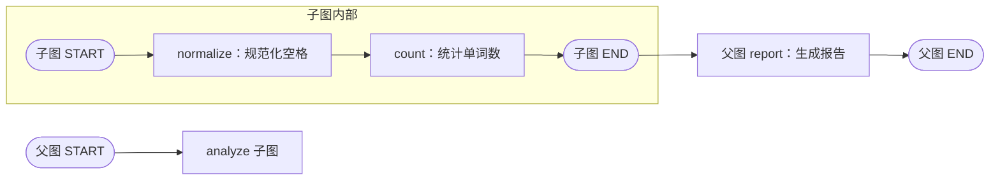

# LangGraph 入门第六课：用子图封装流程，设计清晰的父子状态接口

> 本文配套课程示例：`subgraph_demo.py`。示例通过空白分隔来规范化英文文本并统计单词数，不调用模型或外部服务。

当一个工作流逐渐变大，某段流程可能有自己的 State、节点和边，也希望在多个父图中复用。这时可以把它编译成一张子图，再作为父图中的一个节点使用。

子图并不是“在普通节点里随便调用另一个函数”的别名。它适合封装一段有自身执行结构的流程；父图则通过明确的输入、输出字段与它连接。

## 本课的小型子流程

子图负责两步：先规范化空格，再统计单词数。



子图到达自己的 `END` 后，父图的 `analyze` 节点完成，父图继续执行 `report`。

## 先定义并编译子图

```python
from typing_extensions import TypedDict
from langgraph.graph import END, START, StateGraph


class AnalysisState(TypedDict):
    text: str
    words: list[str]
    word_count: int


def normalize_node(state: AnalysisState):
    words = state["text"].split()
    normalized = " ".join(words)
    return {"text": normalized, "words": words}


def count_node(state: AnalysisState):
    return {"word_count": len(state["words"])}


def build_analysis_subgraph():
    builder = StateGraph(AnalysisState)
    builder.add_node("normalize", normalize_node)
    builder.add_node("count", count_node)
    builder.add_edge(START, "normalize")
    builder.add_edge("normalize", "count")
    builder.add_edge("count", END)
    return builder.compile()
```

调用 `compile()` 得到可执行子图对象；它不会在编译时处理文本。之后父图可以调度它，也可以通过 `invoke()` 单独调用。

## 接法一：父子图共享字段，直接注册子图

父图和子图都需要 `text` 与 `word_count`：

```python
class SharedParentState(TypedDict):
    text: str
    word_count: int
    report: str


def report_node(state: SharedParentState):
    return {
        "report": f"{state['text']} | 单词数={state['word_count']}"
    }


def build_shared_parent(analyzer):
    builder = StateGraph(SharedParentState)
    builder.add_node("analyze", analyzer)
    builder.add_node("report", report_node)
    builder.add_edge(START, "analyze")
    builder.add_edge("analyze", "report")
    builder.add_edge("report", END)
    return builder.compile()
```

把已编译的 `analyzer` 直接交给 `add_node`。父图和子图通过同名、同义且类型兼容的字段交换数据，不需要额外写 `analyzer.invoke(...)` 包装层。

本例中，`words` 只出现在子图的 State 里：`normalize` 生成它，`count` 使用它；父图只共享 `text` 和 `word_count`。所以父图的最终结果包含规范化后的 `text`、单词数和报告，不包含 `words`。

这里说的“子图内部字段”是状态接口范围，不是安全边界。调试或流式追踪时，子图命名空间里的节点输出仍可能被观察到；不要把私有字段当成保密机制。

## 接法二：字段不同，用包装节点做适配

现实中父图和子图可能使用不同字段名，甚至字段结构完全不同。此时由普通节点显式完成输入和输出转换：

```python
class MappedParentState(TypedDict):
    request_text: str
    answer: str
    label: str


def build_mapped_parent(analyzer):
    def call_analysis(state: MappedParentState):
        child_result = analyzer.invoke({"text": state["request_text"]})
        return {
            "answer": (
                f"{child_result['text']} | "
                f"单词数={child_result['word_count']}"
            )
        }

    builder = StateGraph(MappedParentState)
    builder.add_node("analyze", call_analysis)
    builder.add_edge(START, "analyze")
    builder.add_edge("analyze", END)
    return builder.compile()
```

数据流可以读成：

```text
父图 request_text
    → 映射为子图输入 text
    → 子图运行 normalize、count
    → 选取子图输出 text 和 word_count
    → 组装成父图更新 answer
```

包装节点只返回 `answer`，因此父图原有的 `request_text` 和 `label` 保留原值。示例里，`answer` 使用规范化文本和统计结果；`request_text` 仍保留最初的空格。

## 两种接法怎样选择？

| 父子图的关系 | 接法 |
| --- | --- |
| 有含义相同、类型兼容的共享字段 | 将编译后的子图直接注册为节点 |
| 字段名、结构或业务含义不同 | 用包装节点映射输入和输出 |
| 只需要子图结果中的部分字段 | 用包装节点筛选并组装结果 |

包装节点不只是改字段名，也可以做校验、筛选、组合或转换。若子图是一个值得独立复用和维护的多步流程，用子图能保留内部结构；若只是一次简单计算，普通节点可能更清楚。

## 子图不会自动带来跨调用记忆

编译后的子图可以被多个父图复用，但这不表示它会自动记住上一次调用。跨调用状态仍需要按应用的生命周期和线程设计配置 Checkpointer；本课没有设置 Checkpointer，因此两组文本实验都是独立执行。

同样，直接挂载子图也不是“字段名相同就肯定正确”。父子图的共享字段应有一致的含义、兼容的类型和明确的更新规则；若子图使用 Reducer，也要确认父图希望怎样接收和合并这份更新。

## 运行与观察结果

```powershell
python -X utf8 subgraph_demo.py
```

| 场景 | 规范化文本 | 单词数 | 父图结果 |
| --- | --- | ---: | --- |
| 直接注册子图 | `Learn LangGraph step by step` | 5 | `text` 和 `word_count` 共享，`words` 不在父图输出中 |
| 包装节点映射 | `graphs can be reused` | 4 | `answer` 保存结果，原始 `request_text` 与 `label` 保留 |

本例按空白拆分英文单词，不等同于中文分词，也不代表模型 Token 数。

## 本课小结

1. 子图是一张可以作为节点被父图调用的图，适合封装可复用的多步流程。
2. 父子图有兼容的共享 State 字段时，可以把编译后的子图直接添加为节点。
3. 字段不同或需要转换时，在包装节点中显式映射输入与输出。
4. 子图内部字段不进入父图 State 接口，但不构成安全或保密边界。
5. 复用子图对象不会自动保存跨调用状态；持久化仍需要单独配置。

配套代码：`subgraph_demo.py`。至此，课程从单图状态、持久化、中断、消息循环，走到了并发与模块化组合；下一课可以继续学习异常重试与执行恢复。

## 参考资料

- [LangGraph Subgraphs：父子图通信方式](https://docs.langchain.com/oss/python/langgraph/use-subgraphs)
- [LangGraph Graph API：State 与 Reducer](https://docs.langchain.com/oss/python/langgraph/graph-api)
- [LangGraph Subgraphs：共享 State 的示例](https://docs.langchain.com/oss/python/langgraph/use-subgraphs#add-a-subgraph-as-a-node)

**建议标签：** LangGraph、Python、软件架构、AI Agent
