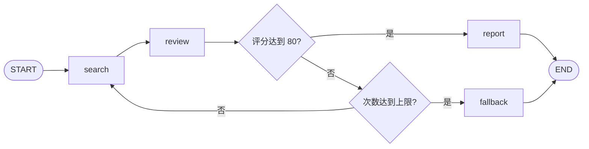

# 第一课：State 更新与条件路由

配套代码：[state_routing_demo.py](../state_routing_demo.py)。它在原有 `test.py` 的思路上增加了搜索历史、逐步观察和次数上限。所有搜索与评分均为模拟。

## 1. 本课要解决的问题

每轮搜索后，我们同时希望：

- `search_result` 只保存最近一次结果。
- `search_history` 保存所有轮次的结果。
- 评分足够时生成报告，不足时继续；次数用完则输出证据不足。

从项目根目录运行：

```powershell
python -X utf8 state_routing_demo.py
```

## 2. 先想普通 Python 会怎么写

不使用框架时，可以手动管理变量和循环。以下为表达流程的伪代码，`search`、`review` 等函数尚未实现：

```python
history = []
for count in range(1, max_searches + 1):
    latest = search(question)
    history.append(latest)
    score = review(latest)
    if score >= 80:
        report = make_report(history)
        break
else:
    report = "证据不足，需要补充信息"
```

LangGraph 中，我们将数据放入 State，步骤放入节点，分支放入条件边。通过这个小例子先理解这些职责；后续再学习框架提供的恢复、人工暂停等能力。

## 3. State 保存数据，节点返回更新

示例中的搜索节点核心代码：

```python
count = state["search_count"] + 1
result = f"第 {count} 轮搜索结果"
return {
    "search_count": count,
    "search_result": result,
    "search_history": [result],
    "stage": "search",
}
```

节点返回的是**本轮需要提交的字段更新**。`question`、`max_searches` 等没有出现在返回值中，它们仍保留原值。

`stage` 是为了打印执行位置而增加的普通字段，不是 LangGraph 内置关键字。`TypedDict` 描述字段类型，不会替你填默认值；示例通过 `initial_state()` 显式初始化输入并检查部分业务约束。[依据：官方状态定义与更新示例](https://docs.langchain.com/oss/python/langgraph/use-graph-api)

## 4. 为什么一个字段覆盖，另一个字段累积？

关键在 State 定义：

```python
from operator import add
from typing import Annotated

search_result: str
search_history: Annotated[list[str], add]
```

未配置 reducer 的字段在本例的顺序更新中直接使用新值。历史字段的 `add` 则执行列表相加，含义相当于：

```python
new_history = old_history + node_update["search_history"]
```

| 更新 | search_result | search_history |
| --- | --- | --- |
| 初始 | `""` | `[]` |
| 搜索第一轮后 | `"第 1 轮搜索结果"` | `["第 1 轮搜索结果"]` |
| 搜索第二轮后 | `"第 2 轮搜索结果"` | `["第 1 轮搜索结果", "第 2 轮搜索结果"]` |

`Annotated` 在这里携带 reducer 元数据，`add` 才是 LangGraph 用来合并此字段的函数。单独写成 `search_history: list[str]` 并不表示自动追加。[依据：Graph API 的 reducers 说明](https://docs.langchain.com/oss/python/langgraph/graph-api#reducers)

这里最容易犯的错误是把完整历史再次返回：

```python
# 对配置了 add 的 search_history，这样会重复累加旧历史。
return {"search_history": state["search_history"] + [result]}
```

例如已有 `[A]`，节点返回 `[A, B]`，框架合并后就成了 `[A, A, B]`。本例应只返回新增的 `[B]`。同理，给累加字段返回 `[]` 不会清空历史，因为旧列表加空列表仍是旧列表。

## 5. 条件边决定下一步，不负责提交状态

审核节点先返回评分更新，再调用路由函数判断：

```python
def route_after_review(state):
    if state["evidence_score"] >= 80:
        return "enough"
    if state["search_count"] >= state["max_searches"]:
        return "exhausted"
    return "retry"
```

路由标签通过显式映射找到节点：

```python
builder.add_conditional_edges(
    "review",
    route_after_review,
    {"enough": "report", "retry": "search", "exhausted": "fallback"},
)
```

因此 `"enough"` 是分支标签，`"report"` 是节点名称。原有 `test.py` 没有传映射，直接返回节点名；两种写法都可以。[依据：官方条件分支示例](https://docs.langchain.com/oss/python/langgraph/use-graph-api)



先检查是否合格，再检查次数，可以让“最后一轮恰好合格”正常生成报告。不要额外添加 `review → search` 的普通边，否则普通边与条件边可能同时调度后续步骤。

## 6. 观察执行结果

代码使用 `graph.stream(..., stream_mode="values")` 逐步打印完整状态中的几个字段。`updates` 模式则用于查看节点提交的更新；这有助于区分“节点返回了什么”和“合并后的状态是什么”。[依据：Streaming](https://docs.langchain.com/oss/python/langgraph/streaming)

场景一的关键输出如下，`input` 为初始状态：

```text
input    | 次数=0 | 评分=0  | 历史条数=0 | 状态=running
search   | 次数=1 | 评分=0  | 历史条数=1 | 状态=running
review   | 次数=1 | 评分=50 | 历史条数=1 | 状态=running
search   | 次数=2 | 评分=50 | 历史条数=2 | 状态=running
review   | 次数=2 | 评分=90 | 历史条数=2 | 状态=running
report   | 次数=2 | 评分=90 | 历史条数=2 | 状态=completed
```

注意第二次 `search` 后评分仍是 50：搜索节点没有更新它，此时它代表上一次审核结果；进入 `review` 后才变为 90。State 中不同字段不一定在同一步刷新，业务上使用时要明确字段含义。

| 场景 | 模拟评分 | 搜索上限 | 最终搜索次数 | 最终状态 |
| --- | --- | --- | --- | --- |
| 第二轮合格 | 50、90 | 3 | 2 | `completed` |
| 到达上限仍不合格 | 40、60、70 | 3 | 3 | `insufficient_evidence` |
| 最后一轮恰好合格 | 50、60、80 | 3 | 3 | `completed` |

验证记录：2026-10-19，在 Python 3.13.7、LangGraph 1.2.4 下运行三个场景，结果与上表一致。

`max_searches` 是业务规则；`recursion_limit` 限制图执行的 super-step 数，并不等于搜索次数。此串行图每轮搜索、审核各占一步，另有一个结束处理节点；达到引擎步数限制会报错，不能替代正常的证据不足分支。[依据：官方循环与步数限制说明](https://docs.langchain.com/oss/python/langgraph/use-graph-api)

## 7. 和 LangChain 对照

| 本课的问题 | 直接使用 LangGraph | LangChain create_agent |
| --- | --- | --- |
| 下一步做什么 | 自己定义节点、边和路由 | 框架提供模型与工具调用循环 |
| 是否继续搜索 | 本例评分与次数共同决定 | 模型通常按工具调用决定行动，也可添加业务约束 |
| 历史数据怎样累积 | 自己定义字段及 reducer | 标准 Agent 使用 messages 状态，也可扩展状态 |
| 流程定制位置 | 图结构与节点函数 | middleware、工具及自定义状态等扩展点 |

`create_agent` 的循环也基于图运行。它不是没有状态和路由，而是封装了常用模式。[依据：LangChain Agents](https://docs.langchain.com/oss/python/langchain/agents)

本例的字符串搜索历史适合用列表 `add`。对话消息通常应使用 `MessagesState` / `add_messages`，因为消息还涉及按 ID 更新等语义，不能一概当成字符串列表拼接。[依据：官方 MessagesState 示例](https://docs.langchain.com/oss/python/langgraph/use-graph-api)

## 8. 自己动手验证

1. 将 `Annotated[list[str], add]` 改成 `list[str]`，重新运行，观察历史是否只剩最后一条。
2. 改成 `run_demo("首轮合格", [80], max_searches=1)`，应一轮成功。
3. 改成 `run_demo("始终不足", [50], max_searches=2)`，评分用完后保持 50，应在两轮后退出。

本课仍使用模拟评分。下一课可让模型产生结构化审核结果，再观察模型判断与程序控制如何配合。
