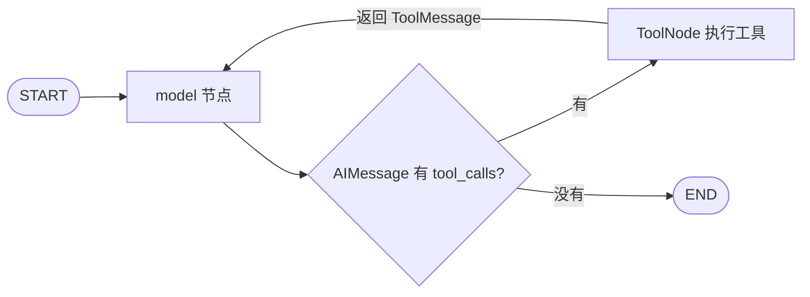

# 案例补充：LangChain 项目的 Agent 循环对照

本篇为可选参考，不承担课程主线。主线第二课见 [Checkpointer 与 thread_id](./02_Checkpointer与thread_id.md)。

本课基于对 `D:\python\Python_AI\Agent!!!!\AgentProject` 的静态阅读，重点是 `Agent_project1.py`。没有启动原项目、调用外部服务或执行数据同步；以下是代码结构分析，不代表线上行为已验证。

配套实验：[aiops_agent_loop_demo.py](../aiops_agent_loop_demo.py)。模型决策和工具数据均为离线模拟，真实运行 LangGraph 的消息循环。

## 1. 先分清你使用的 LangChain 写法

你的代码导入的是：

```python
from langchain_classic.agents import create_tool_calling_agent, AgentExecutor
```

核心组装见 [Agent_project1.py:516](D:/python/Python_AI/Agent!!!!/AgentProject/Agent_project1.py:516)：

```python
agent = create_tool_calling_agent(llm, tools, prompt)
agent_executor = AgentExecutor(agent=agent, tools=tools, verbose=True)
```

这属于经典 AgentExecutor 架构。前面笔记所说的“LangChain Agent 基于 LangGraph”，具体指当前 `langchain.agents.create_agent` 的实现，不能直接套用到这段经典代码上。[经典入口参考](https://reference.langchain.com/python/langchain-classic/agents/tool_calling_agent/base/create_tool_calling_agent)、[当前 Agent 入口](https://docs.langchain.com/oss/python/langchain/agents)

| 构建方式 | 循环怎样组织 | 学习重点 |
| --- | --- | --- |
| 你的经典写法 | Agent 提出行动，AgentExecutor 驱动执行循环 | prompt、scratchpad、executor、history wrapper |
| 当前 LangChain `create_agent` | 封装在 LangGraph 上的标准 Agent 循环 | messages、middleware、checkpointer |
| 自己写 LangGraph | 明确添加决策节点、工具节点和路由 | 状态更新、消息协议、控制流程 |

这里是在区分 API 架构，没有读取原项目环境锁文件，不能据此判断它实际安装的依赖版本。

## 2. 你的项目有哪些部分？

| 部分 | 代码位置 | 实际职责 |
| --- | --- | --- |
| 模型 | `Agent_project1.py:478` | 通过 ChatOpenAI 接口配置 DeepSeek |
| 工具集合 | `Agent_project1.py:472` | 将 7 个工具交给 Agent |
| 行为约束 | `Agent_project1.py:489` | 系统提示词及历史、当前输入、scratchpad 槽位 |
| Agent 循环 | `Agent_project1.py:516` | 创建 Agent 并交给 AgentExecutor |
| 对话历史 | `Agent_project1.py:524` | Redis 历史与 RunnableWithMessageHistory |
| RAG 检索 | `Agent_project1.py:455` | 调用 MultiQueryRetriever 检索 Pinecone 文档 |
| 对外接口 | `Agent_project1.py:666` | FastAPI 接收问题，事件转 SSE |
| 知识同步 | `Agent_project1.py:546`、`:604` | 切片、向量更新、版本比对 |

工具包括：服务状态查询、服务列表查询、MySQL 查询、Redis 查询、本地日志查询、TraceId 链路查询、内部知识库检索。

这是一个以单 Agent 为核心的运维助手。`rewrite_llm` 为检索生成查询，并不因此成为另一个独立 Agent；文档同步任务也是应用后台任务。工具数量、模型实例数量、后台任务数量与 Agent 数量不是一回事。

## 3. AgentExecutor 帮你执行了什么？

你没有在业务代码中手写循环，但每次请求大致经过：

```text
新问题 + 历史对话 + 系统提示词
               ↓
模型输出工具请求，或直接给最终回答
               ↓ 有工具请求
执行对应工具 → 收集结果 → 填入本轮 scratchpad
               ↓
再次调用模型，直到最终回答或触及执行器限制
```

`create_tool_calling_agent` 负责组合模型、工具定义、提示词及输出解析等；`AgentExecutor` 驱动行动与工具执行。`agent_scratchpad` 用于放入本轮中间行动和工具结果。[依据：经典 Agent API](https://reference.langchain.com/python/langchain-classic/agents/tool_calling_agent/base/create_tool_calling_agent)、[AgentExecutor](https://reference.langchain.com/python/langchain-classic/agents/agent/AgentExecutor)

`chat_history` 与 `agent_scratchpad` 的职责不同：前者提供会话历史，后者承载当前执行过程中的中间记录。你的提示词分别为二者保留了槽位。

## 4. 换成 LangGraph，循环长什么样？



本课示例的组装代码：

```python
builder = StateGraph(MessagesState)
builder.add_node("model", scripted_model_node)
builder.add_node("tools", ToolNode(TOOLS))
builder.add_edge(START, "model")
builder.add_conditional_edges(
    "model", tools_condition, {"tools": "tools", "__end__": END},
)
builder.add_edge("tools", "model")
graph = builder.compile()
```

`ToolNode` 按模型给出的工具名与参数调用工具，并产生对应结果消息。`tools_condition` 查看末尾 AI 消息是否有工具调用，从而继续或结束。这是 Agent 常见循环的一种显式实现。[依据：官方 LangGraph Quickstart](https://docs.langchain.com/oss/python/langgraph/quickstart)、[工具执行节点](https://docs.langchain.com/oss/python/langchain/tools)

## 5. 三种消息怎样配合？

| 消息 | 谁产生 | 内容 |
| --- | --- | --- |
| `HumanMessage` | 用户输入转换而来 | “请求 T-1001 超时了” |
| `AIMessage`，带 `tool_calls` | 模型；本例由脚本模拟 | 工具名、参数、调用 ID |
| `ToolMessage` | 工具执行节点 | 工具结果、对应的 `tool_call_id` |
| `AIMessage`，不带工具请求 | 模型；本例由脚本模拟 | 最终回答 |

工具请求的 `id` 与结果的 `tool_call_id` 配对，告诉模型“这条结果回答的是哪次请求”。工具调用属于结构化消息，不是让模型在普通回答里写一句“我要查数据库”就会自动执行。

第一课的历史字段使用 `operator.add`；本课采用内置 `MessagesState`，其中 messages 使用 `add_messages`，支持新消息加入及按消息 ID 更新。节点仍只返回新增消息：[依据：Graph API 消息状态说明](https://docs.langchain.com/oss/python/langgraph/graph-api)

```python
return {"messages": [new_ai_message]}
```

## 6. 运行与实际输出

```powershell
python -X utf8 aiops_agent_loop_demo.py
```

实际运行得到两条路径：

```text
商品查询慢：
  search_internal_docs
  → get_nacos_service_list
  → check_nacos_service_status
  → 最终回答

带 T-1001：
  query_trace_logs
  → search_internal_docs
  → 最终回答
```

终端会打印每条 AIMessage 的工具名、参数、调用 ID，以及 ToolMessage 对应的结果。

验证记录：2026-10-19，在当前 Python 3.13.7、LangGraph 1.2.4 环境下，两条路径运行通过。示例复用当前环境的 `langchain-core`，不需要安装 `langchain` 主包。

重要边界：`scripted_model_node` 是用 Python 规则模拟模型输出；工具函数返回固定数据。因此它验证消息循环和路由机制，不验证真实模型能力，也没有完成原应用的整体迁移。每次演示从一个新问题开始，没有跨轮对话记忆。

## 7. 你的提示词要求，怎样变成程序要求？

原项目的提示词同时包含：

- 具体报错优先检索内部知识库。
- 查询线上服务前先拉取真实服务列表。
- 提供 TraceId 时优先查询链路日志。

遇到既有具体报错又有 TraceId 的请求，“优先”的顺序需要进一步定义。提示词能影响模型选择，代码中尚没有用执行结构保证这些前置步骤。

可以按业务需要选择：

| 要求 | 可以怎样实现 |
| --- | --- |
| 服务状态查询前必须获取服务列表 | 图中显式安排前置节点，或由工具自身验证前置数据 |
| 有 TraceId 必须先查链路 | 前置条件路由直接进入链路节点 |
| 最多查询三轮 | State 保存次数，并在调度前检查 |
| 证据不够必须说明不足 | 独立审核与退出节点，明确合格条件 |

本课离线示例把“有 TraceId 先查链路”的规则写在 Python 决策函数里，便于观察。以后将该函数替换成真实模型时，这个硬约束也会随之消失；要保留它，需放到模型之外的图结构或校验逻辑中。

**学 LangGraph 的一个重点，是明确哪些决定交给模型，哪些条件必须由程序保证。** 使用 LangGraph 本身不会自动保证工具顺序或证据质量。

## 8. Redis 聊天历史与 Checkpointer 的区别

你在 [Agent_project1.py:529](D:/python/Python_AI/Agent!!!!/AgentProject/Agent_project1.py:529) 配置了 RedisChatMessageHistory，并设定 24 小时 TTL；通过 `session_id` 选择历史。

这能帮助下一次请求继续聊天，但不能仅凭这套历史包装器，就恢复一次中途退出的工具执行流程。

| 机制 | 主要保存什么 | 在迁移时要考虑什么 |
| --- | --- | --- |
| 原有会话历史 | 对话消息 | 如何将已有记录转换为新应用的 messages 输入 |
| LangGraph Checkpointer | 某个 thread 的图状态及执行进度等 | thread 划分、存储后端、保留策略 |
| LangGraph Store | 应用定义的跨 thread 数据 | 用户偏好、事实等长期数据的读写策略 |

`session_id` 可作为映射到 `thread_id` 的起点，但两者不只是换个字段名：还应明确一个 ID 代表用户还是某次会话。迁移也不会自动继承旧 Redis 历史或 24 小时 TTL 策略。[依据：LangChain 短期记忆](https://docs.langchain.com/oss/python/langchain/short-term-memory)

## 9. 以后接真实模型，需要替换哪里？

下列为结构示意，尚未运行；需要单独准备模型依赖、环境变量与可用服务：

```python
import os
from langchain_openai import ChatOpenAI
from langchain_core.messages import SystemMessage

model = ChatOpenAI(
    model="deepseek-chat",
    base_url="https://api.deepseek.com",
    api_key=os.environ["DEEPSEEK_API_KEY"],
)
model_with_tools = model.bind_tools(TOOLS)

async def model_node(state: MessagesState):
    reply = await model_with_tools.ainvoke(
        [SystemMessage(content="你是排障助手，结论须基于工具证据。")]
        + state["messages"]
    )
    return {"messages": [reply]}
```

将图中的 `scripted_model_node` 替换成 `model_node`，并改用 `await graph.ainvoke(...)`。原项目工具大多是 `async def`，接入它们时应使用异步执行路径。[依据：官方模型与工具循环示例](https://docs.langchain.com/oss/python/langgraph/quickstart)

这个代码块仍连接本课的模拟工具。要接真实工具，应先将工具及其客户端初始化从原主模块拆开；直接导入 `Agent_project1.py` 会执行顶层客户端和向量库初始化，不能把它当作无副作用的工具模块。

## 10. 回到 LangGraph 学习主线

本案例用于帮助辨认模型节点、工具节点和消息。后续依次学习 Checkpointer、人工中断与恢复、并发合并以及子图。

RAG 检索、FastAPI 和 SSE 属于应用中的其他职责；学习时先集中理解 LangGraph 本身的状态与执行机制。
