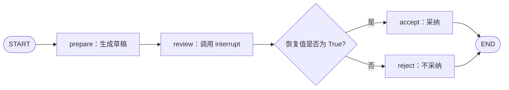

# 第三课：中断与恢复

第二课解决了“状态怎样跨次调用保留”。这节继续观察：执行到一半需要外部输入时，图怎样暂停、取得输入并继续。

配套代码：[interrupt_demo.py](../interrupt_demo.py)。所有步骤均为本地模拟，不需要模型或外部服务。

## 1. 本课的图



中断发生在 `review` 节点内部。`interrupt()` 提供等待外部输入的暂停点；条件边则在节点完成后决定下一步，两者职责不同。

## 2. 两个核心 API

在节点内部暂停：

```python
from langgraph.types import interrupt

def review_node(state):
    approved = interrupt({"question": "是否采纳？", "draft": state["draft"]})
    return {"approved": approved}
```

在调用方恢复：

```python
from langgraph.types import Command

config = {"configurable": {"thread_id": "review-001"}}
paused = graph.invoke(initial_state, config)
result = graph.invoke(Command(resume=True), config)
```

使用动态中断需要配置 checkpointer，并在恢复时使用相同 thread_id 和可访问原 checkpoint 的存储。`Command(resume=True)` 中的 `True` 会成为节点内 `interrupt()` 的返回值。[依据：官方 Interrupts 文档](https://docs.langchain.com/oss/python/langgraph/interrupts)

## 3. 首次执行发生了什么？

运行：

```powershell
python -X utf8 interrupt_demo.py
```

程序先输出：

```text
[prepare] 生成草稿
[review] 从节点开头执行，即将到达 interrupt
已返回调用方，中断载荷： {...}
待继续的节点： ('review',)
```

此时：

1. `prepare` 已完成，返回的草稿和 `status="draft_ready"` 已保存。
2. `review` 运行到 `interrupt()` 后暂停，尚未执行后面的判断和 `return`。
3. `invoke()` 将控制权交回调用方，调用方从 `paused["__interrupt__"][0].value` 取得暂停载荷。
4. `accept` 和 `reject` 都没有执行。

本例使用默认 `invoke()` 返回格式。`__interrupt__` 是框架提供的中断信息，不需要在 State 中声明这个字段。

它也不会自动创建输入框或弹窗。终端、网页等应用负责展示载荷、收集输入，并发起恢复调用；本例直接用预设布尔值模拟外部回复。

## 4. 恢复时最关键的行为：节点重新执行

传入 `Command(resume=True)` 后，输出：

```text
[review] 从节点开头执行，即将到达 interrupt
[review] interrupt 已返回：True
[accept] 采纳草稿（模拟）
最终状态： accepted
待执行节点： ()
```

请特别注意第一行又出现了。恢复流程可以按下面的顺序理解：

```text
读取已保存的执行上下文
    ↓
重新进入 review 节点，从函数开头执行
    ↓
到达对应的 interrupt 调用，取得恢复值 True
    ↓
执行后续代码，返回 approved=True 的状态更新
    ↓
条件边读取更新后的状态，进入 accept
```

因此，`interrupt()` 之前的普通代码会再次执行。Python 函数的局部变量和调用栈不会像调试器断点那样原封不动地保留。本例中已完成的 `prepare` 则没有重跑。[依据：官方恢复规则](https://docs.langchain.com/oss/python/langgraph/interrupts)

这就是我们把草稿生成与审核分成两个节点的原因：已完成的准备工作可以独立形成执行边界。

## 5. 中断载荷、恢复值、State 更新是三件事

| 数据 | 传递方向 | 本例内容 |
| --- | --- | --- |
| `interrupt(payload)` 的 payload | 节点 → 调用方 | 问题和待审核草稿 |
| `Command(resume=value)` 的 value | 调用方 → 节点 | `True` 或 `False` |
| 节点 `return` 的字典 | 节点 → State | approved 和 status |

传入恢复值不会自动把 State 的 `approved` 字段改掉；本例是在 `review_node` 返回后，才提交该字段更新。

首次中断时，State 中 `approved=False` 只是输入的初始值，不代表已经作出了否定决定；此时 `status="draft_ready"`，图仍在等待审核。因此读取状态时应同时理解业务阶段。

示例显式检查恢复值是布尔类型。字符串 `"False"` 在 Python 条件判断中是真值，不能直接当作布尔型 `False` 使用。

## 6. 和上一课的调用方式对照

| 场景 | 调用方式 | 用意 |
| --- | --- | --- |
| 已结束一轮，提交新的输入 | `graph.invoke(new_input, config)` | 在同一 thread 发起新一轮执行 |
| 正在等待 interrupt 的外部回复 | `graph.invoke(Command(resume=value), config)` | 为待处理的中断提供恢复值 |

传普通字典是提交 State 输入，不能将它等同于 `Command(resume=...)`。

`graph.get_state(config).next` 在本例暂停时为 `('review',)`，结束后为 `()`。若要查看具体等待的问题，还应检查中断信息；仅凭 `next` 有值不能判断所有暂停或未完成的原因。[依据：官方 StateSnapshot 字段](https://docs.langchain.com/oss/python/langgraph/checkpointers)

## 7. 从这个机制推导出的写法

- 暂停前的计算可能重跑；成本高的准备工作适合拆成前置节点。
- 暂停前如果写库、发消息等，重执行可能重复产生副作用，应设计幂等或单独的执行边界。放到后续节点也不能自动保证任意故障下恰好执行一次。
- 不要用宽泛的异常处理吞掉中断信号；中断需要由 LangGraph 运行时处理。
- 一个节点包含多个 interrupt 时，恢复值与调用顺序有关；本阶段先掌握单个中断，再学习多个中断的配对。

本例用 `InMemorySaver`，演示在同一进程中暂停与恢复。退出进程后的恢复需要持久化 checkpoint 存储；本课不把内存实验当作跨重启验证。[依据：Persistence](https://docs.langchain.com/oss/python/langgraph/persistence)

LangChain 对照只记一点：当前 `create_agent` 的人工介入能力也可以使用底层 LangGraph 机制；直接使用 LangGraph 时，我们明确决定中断发生在哪个节点、如何处理恢复后的分支。[依据：LangChain 人工介入](https://docs.langchain.com/oss/python/langchain/human-in-the-loop)

## 8. 实验结果与练习

| 恢复输入 | prepare 日志次数 | review 开头日志次数 | 最终状态 |
| --- | --- | --- | --- |
| `True` | 1 | 2 | `accepted` |
| `False` | 1 | 2 | `rejected` |

验证记录：2026-10-19，在当前 Python 3.13.7、LangGraph 1.2.4 环境下，两条路径均已运行，结果与上表一致。

先预测再动手：

1. 在 `interrupt()` 前后分别加一条日志，统计首次调用与恢复调用各打印哪些内容。
2. 将 `run_demo(False)` 改为 `run_demo("False")`，观察为什么显式类型检查会报错。
3. 观察暂停时的 `snapshot.values`：为什么 status 还是 draft_ready，而不是 reviewed？

下一课学习 LangGraph 中的消息状态与 Agent 循环：让模型节点、工具节点通过消息和条件边组成循环，继续关注图的执行机制。
