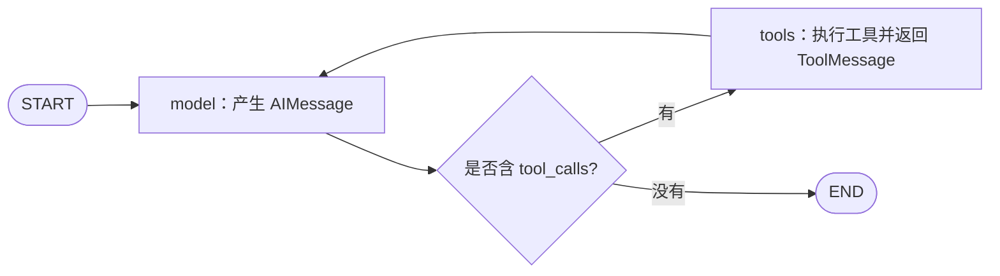

# 第四课：消息状态与 Agent 循环

前面学过 State、条件路由、Checkpointer 和中断。这节把 State 中的数据换成对话消息，搭建一个“决策 → 工具 → 再决策”的循环。

配套实验：[message_loop_demo.py](../message_loop_demo.py)。决策节点用固定 Python 规则模拟模型输出，加法与乘法工具实际执行。本课验证 LangGraph 的消息与执行机制，不涉及真实模型服务，也不解析自然语言。

## 1. 先看图的结构



决定工具名称和参数的是决策节点；检查是否有工具请求的是条件边；实际执行工具的是工具节点。三个职责分开后，执行流程就明确了。[依据：官方 LangGraph Quickstart](https://docs.langchain.com/oss/python/langgraph/quickstart)

## 2. messages 是 State 的一个字段

本课定义：

```python
class CalculatorState(MessagesState):
    left: int
    right: int
    multiplier: int | None
    model_steps: int
```

它包含继承的 `messages` 字段，以及我们自己增加的参数和计数。模型消息只是状态的一部分，State 还可以记录业务数据、次数等。

`MessagesState` 已经为 messages 配置了 `add_messages` reducer。节点仍然只需返回本次产生的新消息：[依据：Graph API 的 MessagesState](https://docs.langchain.com/oss/python/langgraph/graph-api)

```python
return {"messages": [reply], "model_steps": step}
```

注意，State 中有数据，并不等于真实模型已收到这些数据；调用模型时仍需要显式组织输入。本例的 Python 决策函数直接读取 left/right，真实模型接入时则需要收到相应的问题或上下文。

## 3. 各种消息分别代表什么？

| 类型 | 作用 | 本课的例子 |
| --- | --- | --- |
| HumanMessage | 用户输入 | 请计算 `(2 + 3) * 4` |
| AIMessage，带 tool_calls | 模型提出的结构化工具请求 | 调用 add，参数 a=2、b=3 |
| ToolMessage | 工具执行结果 | 加法结果为 5 |
| AIMessage，不带工具请求 | 模型的普通输出 | 结果是 20 |
| SystemMessage | 给模型的角色、要求等 | 本离线实验未使用 |

一个 AIMessage 可以带工具请求，即使它的正文 content 是空字符串，也不能把它当作“没有输出”。决定是否执行工具，要检查 `tool_calls`。[依据：LangChain 工具调用说明](https://docs.langchain.com/oss/python/langchain/tools)

## 4. 工具请求只是数据

决策节点产生的请求类似：

```python
AIMessage(
    content="",
    tool_calls=[{
        "name": "add",
        "args": {"a": 2, "b": 3},
        "id": "call_1",
        "type": "tool_call",
    }],
)
```

这条消息本身没有执行加法。它声明“希望调用名为 add 的工具，并传入这些参数”。工具节点根据工具注册表找到函数，执行后产生对应的 ToolMessage。

在本次运行中，可以观察到这样的配对：

```text
AIMessage.tool_calls[0].id = call_1
ToolMessage.tool_call_id  = call_1
ToolMessage.content       = "5"
```

因此即使一个工具被调用多次，也能按调用 ID 区分每个结果对应的请求。

## 5. MessagesState 怎样合并消息？

本课最后一个小实验直接调用 `add_messages`：

```python
original = [HumanMessage(content="最初的问题", id="user-1")]
corrected = add_messages(
    original,
    [HumanMessage(content="修改后的问题", id="user-1")],
)
```

结果仍然只有一条消息，内容变成“修改后的问题”。再加入不同 ID 的消息，则会保留原消息并加入新消息。

| 规则 | operator.add 处理列表 | add_messages 处理消息 |
| --- | --- | --- |
| 普通追加 | 将两个列表拼接 | 新 ID 的消息加入列表 |
| 相同消息 ID | 仍然拼接，产生两条 | 更新已有消息 |
| 典型用途 | 普通记录或结果列表 | 对话消息状态 |

这里有两种不同的 ID，不要混淆：

- **消息自身的 `message.id`**：`add_messages` 用它识别是否更新已有消息。
- **工具请求的 `tool_call.id`**：与 `ToolMessage.tool_call_id` 配对，关联请求和结果。

即使都叫 ID，它们也解决不同的问题。[依据：Graph API 的 add_messages 说明](https://docs.langchain.com/oss/python/langgraph/graph-api)

## 6. 工具节点与条件边怎样组装？

本课的关键代码：

```python
builder.add_node("model", scripted_model_node)
builder.add_node("tools", ToolNode(TOOLS))
builder.add_edge(START, "model")
builder.add_conditional_edges(
    "model", tools_condition, {"tools": "tools", "__end__": END},
)
builder.add_edge("tools", "model")
```

`ToolNode` 执行已注册的工具并返回结果消息；`tools_condition` 检查最后一条 AI 消息中的工具请求，选择工具节点或 END。[依据：官方工具执行说明](https://docs.langchain.com/oss/python/langchain/tools)

最后这条 `tools → model` 的边很关键：工具输出回到模型，模型才能基于结果决定下一步或组织回答。

本图把“没有工具请求”作为结束条件。这表示循环结束，不代表模型答案已经通过正确性评估；若需要审核质量，应增加对应的业务检查。

## 7. 逐步理解一次实际运行

从项目根目录运行：

```powershell
python -X utf8 message_loop_demo.py
```

计算 `(2 + 3) * 4` 时，消息按顺序累积：

| 步骤 | 新增消息 | 含义 |
| --- | --- | --- |
| 输入 | HumanMessage | 请计算表达式 |
| 第一次 model | AIMessage | 请求 add(2, 3) |
| 第一次 tools | ToolMessage | 返回 5 |
| 第二次 model | AIMessage | 读取 5，再请求 multiply(5, 4) |
| 第二次 tools | ToolMessage | 返回 20 |
| 第三次 model | AIMessage | 回答“结果是 20”，不再请求工具 |

循环中每次 model 进入时，State 已包含此前积累的消息。不同轮次共用同一组节点，消息和状态随轮次变化。

| 场景 | 决策节点运行次数 | 工具执行次数 | 最终消息条数 | 结果 |
| --- | --- | --- | --- | --- |
| `2 + 3` | 2 | 1 | 4 | 5 |
| `(2 + 3) * 4` | 3 | 2 | 6 | 20 |

验证记录：2026-10-19，在当前 Python 3.13.7、LangGraph 1.2.4 环境下，两条路径与消息 ID 合并实验均已运行，结果与本节说明一致。

## 8. 接真实模型时，改变哪里？

主要替换决策节点。下面仅展示接口结构，model 代表已初始化且支持工具调用的聊天模型，尚未在本课运行：

```python
model_with_tools = model.bind_tools(TOOLS)

def model_node(state: CalculatorState):
    reply = model_with_tools.invoke(state["messages"])
    return {
        "messages": [reply],
        "model_steps": state["model_steps"] + 1,
    }
```

`bind_tools` 让模型接口取得工具名称、说明和参数 schema；它不会代替 ToolNode 执行这些工具。接入真实模型后，工具选择及参数来自模型输出，图负责后续执行与流转。[依据：官方模型绑定工具示例](https://docs.langchain.com/oss/python/langgraph/quickstart)

本课脚本中的自然语言问题只用于展示，决策规则读取预设参数；它不是任意表达式求值器，也没有使用 eval。

## 9. 与已学概念连接

- **Reducer**：负责新消息如何合并到历史。
- **条件边**：负责工具循环继续还是结束。
- **Checkpointer**：若希望消息跨次调用保留，可以配置它；本课未配置，每次演示都从新状态开始。
- **interrupt**：需要外部确认时，可以在工具执行前增加对应节点，使用上一课的暂停与恢复机制。

和 LangChain 对照：当前 `create_agent` 提供常用循环，直接使用 LangGraph 则由你编排节点与控制规则。使用 LangChain 的消息或工具组件，不意味着执行流程必须交给 `create_agent`。[依据：LangChain overview](https://docs.langchain.com/oss/python/langchain/overview)

## 10. 小练习

1. 将 `run_demo(2, 3, multiplier=4)` 改为 `run_demo(2, 3, multiplier=0)`，预测有几条消息，最终结果是什么。
2. 对照输出区分每个请求 ID 和对应的结果 ID。
3. 在 `show_message_merge()` 中把第二条 HumanMessage 的 ID 改为 user-2，观察消息数量。

接着阅读[第五课：并发与合并](./05_并发与合并.md)：两个分支能否同时运行？它们写入同一 State 字段时，LangGraph 怎样处理？
