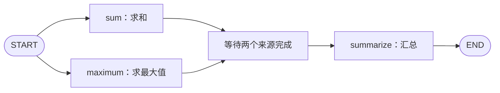

# 第五课：并发与合并

之前的流程主要沿一条路径前进。这节学习两个分支都需要执行时，如何分发任务、等待汇总，以及合并它们对 State 的更新。

配套代码：[parallel_merge_demo.py](../parallel_merge_demo.py)。它对 `[2, 3, 5]` 分别求和、求最大值，再生成报告，不需要模型服务。

## 1. fan-out 与 fan-in



- **fan-out**：从一个位置分出多个都要执行的分支。
- **fan-in**：将分支结果汇集起来，继续后续步骤。

图中的“等待两个来源完成”表示依赖关系，代码中没有额外注册这个节点。

这与条件边二选一不同：这里的两个统计分支都执行。条件路由也可以选择多个目标，但本课先使用固定分支。[依据：官方并行分支示例](https://docs.langchain.com/oss/python/langgraph/use-graph-api)

## 2. 代码怎样表达分发与等待？

```python
builder.add_edge(START, "sum")
builder.add_edge(START, "maximum")
builder.add_edge(["sum", "maximum"], "summarize")
```

前两行将两个分支都加入执行路径；第三行用来源节点列表声明：等 sum 和 maximum 都完成后，再调度 summarize。

列表形式的边不是两个单独 add_edge 调用的缩写。在这个同层的小图中，单独连边可能看起来也得到同样结果，但当分支长度不同，不能把它当作通用的“等待所有来源”写法。本课两个分支固定都会执行，使用列表边表达依赖更明确。[依据：官方分支汇合说明](https://docs.langchain.com/oss/python/langgraph/use-graph-api)

## 3. super-step：分支在哪个时刻看到状态更新？

可以将 super-step 理解为图的一轮执行：同一轮里，被调度的节点可以并发处理各自的输入；本轮的状态更新合并后，供后续轮次使用。

本例的业务节点分成两轮：

| 轮次 | 执行的节点 | 节点读取的数据 |
| --- | --- | --- |
| 第一轮 | sum、maximum | 初始 numbers 与空 findings |
| 第二轮 | summarize | 已合并两条 findings 的状态 |

这里聚焦业务节点，未列出内部输入处理步骤或 checkpoint。

示例中 sum 较早返回；maximum 即使稍后才完成，读取到的 findings 仍然是本轮输入中的空列表。sum 的返回值会由运行时收集，不能据此认为另一个同轮节点马上就能读取它。[依据：Graph API 执行模型](https://docs.langchain.com/oss/python/langgraph/graph-api)

因此，如果 B 必须依赖 A 的返回值，应建立 `A → B` 的执行依赖，而不是将 A、B 放在同一个并行层并期望 B 碰巧等到结果。

## 4. 两个分支怎样更新同一字段？

State 中定义：

```python
class ParallelState(BaseState):
    findings: Annotated[list[Finding], add]
```

其中 Finding 是包含 metric 和 value 的字典。两个分支分别返回：

```python
# sum
{"findings": [{"metric": "sum", "value": 10}]}

# maximum
{"findings": [{"metric": "maximum", "value": 5}]}
```

因为 findings 配置了列表相加 reducer，运行时能够把两份更新合并到这个字段中。每个节点只需返回自己的新增结果，无需读出旧列表再拼接。

汇总节点按 metric 取值：

```python
values = {item["metric"]: item["value"] for item in state["findings"]}
report = f"总和={values['sum']}；最大值={values['maximum']}"
```

这避免把列表下标当作分支标识。不要将 reducer 结果的排列直接理解为节点实际完成顺序；需要特定展示顺序时，应按业务字段显式排序。

## 5. 为什么没有 reducer 会报错？

对照版本只改变 schema：

```python
class ConflictState(BaseState):
    findings: list[Finding]
```

第一课里，未配置 reducer 的字段在顺序更新时直接使用新值。但在本例中，同一个 super-step 有两个节点同时向 findings 提交更新，默认字段不能接受这种多值写入，因此抛出 `InvalidUpdateError`。

**“顺序更新覆盖旧值”不能推广为“并发时最后完成的节点获胜”。** 本课的第二个实验专门捕获并展示这个错误。[依据：官方 INVALID_CONCURRENT_GRAPH_UPDATE 说明](https://docs.langchain.com/oss/python/langgraph/errors/INVALID_CONCURRENT_GRAPH_UPDATE)

还要避免把完整 State 原样返回：

```python
# 不建议：把只读取的其他字段也再次提交为更新。
return {**state, "findings": [my_finding]}
```

两个分支若都这样做，numbers、report 等未配置 reducer 的字段也会被重复写入，可能产生额外冲突；findings 的旧记录也可能重复累积。只返回本节点实际更新的字段即可。

## 6. 并行节点一定需要 reducer 吗？

不一定。关键看它们是否在同一步向同一个字段提交多份更新。

| 更新方式 | 本例中的合并处理 |
| --- | --- |
| A 写 sum_result，B 写 max_result | 字段不同，可分别保存，无需为并发专门配置 reducer |
| A、B 都写 findings，普通列表字段 | 多值写入冲突 |
| A、B 都写 findings，配置列表 add | 合并两份列表更新 |

因此还可以选择把不同结果放在不同字段中。字段划分和 reducer 都是状态设计的一部分，不是看到并发就给所有字段加 add。

## 7. 运行与观察

```powershell
python -X utf8 parallel_merge_demo.py
```

程序依次运行两组实验：

1. 有 reducer：两个分支启动，各自读到 0 条已有结果；分支结束后，summarize 读到两条结果，输出“总和=10；最大值=5”。
2. 无 reducer：两个分支返回后，合并时出现 InvalidUpdateError，汇总节点没有执行。

节点开始日志的先后不应作为业务逻辑依据。要观察的是：两个开始日志都在分支结束前出现；汇总在两个分支完成后出现；后续轮次能够读到合并结果。

验证记录：2026-10-20，在 LangGraph 1.2.4 下，两组实验均已运行。第一组得到总和 10、最大值 5；第二组捕获了 findings 字段的 InvalidUpdateError，且未进入 summarize。本次运行 sum 先完成，而结果列表先列 maximum，再列 sum，进一步说明列表位置不能用来推断完成时序。

## 8. async 与性能的边界

本课使用普通 `def` 节点，用 `time.sleep(...)` 模拟 I/O 等待，由 `graph.invoke(...)` 调度执行。同一并行层的同步节点也可以并发运行，不要求全部写成 async def。

更复杂的 I/O 流程也可使用 `async def` 节点和 `graph.ainvoke(...)`。并发能够让等待过程交叠，但不代表任意 CPU 密集型 Python 计算都会自动加速。实际耗时还取决于任务类型、调度开销、资源与服务限流；本例不作为性能基准。

## 9. 和 LangChain 简短对照

LangChain 的 RunnableParallel 可以将同一输入分发给多个组件并汇集输出。这里学习的 LangGraph 机制还需要明确图中的后续依赖，以及多个节点对 State 字段的更新规则。[依据：RunnableParallel 参考](https://reference.langchain.com/python/langchain-core/runnables/base/RunnableParallel)

本课的两个统计节点都是普通函数。把节点换成检索器、模型调用或一个子流程后，仍需要考虑这些依赖与状态合并问题。

## 10. 小练习

1. 交换两个 time.sleep 的等待时长，观察汇总是否仍然包含两份结果。
2. 让 sum 节点额外返回 `"report": "sum done"`，maximum 额外返回 `"report": "max done"`，预测哪个字段会出现冲突。
3. 将两个分支改成分别写 sum_result 和 max_result，体会“独立字段”与“共享列表”的两种设计。

接着阅读[第六课：子图与状态接口](./06_子图与状态接口.md)：怎样将一段完整流程封装成一个节点，以及父图和子图怎样传递状态。
