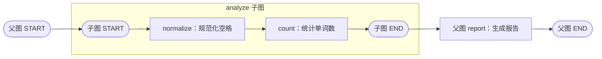

# 第六课：子图与状态接口

配套代码：[subgraph_demo.py](../subgraph_demo.py)。本课用“规范化空格 → 统计单词数”这段小流程，观察父图和子图怎样组合、怎样传递数据。

## 1. 子图是什么？

子图是作为另一张图的节点使用的图。它内部仍然有自己的 State、节点和边；父图通过接口使用它，从而复用一段完整流程。[依据：官方 Subgraphs 文档](https://docs.langchain.com/oss/python/langgraph/use-subgraphs)

本课第一组实验的结构：



父图将 analyze 当作一个节点使用，子图内部则执行两个节点。子图到达自己的 END 表示这段子流程完成，结果返回父图，父图再沿自己的边继续。

## 2. 先定义可复用的子图

子图状态：

```python
class AnalysisState(TypedDict):
    text: str
    words: list[str]
    word_count: int
```

两个节点分别负责：

- normalize：读取 text，用 split 分割，再用单个空格连接，返回 text 和 words。
- count：读取 words，返回 word_count。

然后将节点连起来，编译成可执行图：

```python
builder.add_edge(START, "normalize")
builder.add_edge("normalize", "count")
builder.add_edge("count", END)
analyzer = builder.compile()
```

`compile()` 构建可执行对象，这时尚未处理文本；后续通过 invoke，或由父图调度，才开始运行。本课按空白分隔英文单词，不进行中文分词或模型 token 计数。

## 3. 接法一：共享状态字段，直接注册子图

父图状态：

```python
class SharedParentState(TypedDict):
    text: str
    word_count: int
    report: str
```

父子图共享 text、word_count；父图另外维护 report，子图内部维护 words。

```python
parent_builder.add_node("analyze", analyzer)
parent_builder.add_node("report", report_node)
parent_builder.add_edge(START, "analyze")
parent_builder.add_edge("analyze", "report")
parent_builder.add_edge("report", END)
```

直接传入的是编译后的子图对象，不需要写成 `analyzer.invoke(...)`；那样会立即调用并得到结果，而 add_node 需要的是以后可以执行的节点。[依据：官方共享字段接法](https://docs.langchain.com/oss/python/langgraph/use-subgraphs)

本次运行中：

| 字段 | 属于父图 | 属于子图 | 用途 |
| --- | --- | --- | --- |
| text | 是 | 是 | 父图提供文本，子图返回规范化后的文本 |
| word_count | 是 | 是 | 子图返回统计结果，父图继续使用 |
| words | 否 | 是 | 子图内部的中间结果 |
| report | 是 | 否 | 父图根据结果生成报告 |

父子图的 schema 不必完全一致。共享字段应约定兼容的类型与相同的数据含义，不能只靠名称相同就认定接口合适。

父图最终结果中没有 words。这里的“内部字段”描述状态接口边界；调试或子图流式输出仍可以展示内部数据，不应把接口边界理解为数据完全不可见。

## 4. 接法二：字段不同，写包装节点转换

第二个父图使用另一套字段：

```python
class MappedParentState(TypedDict):
    request_text: str
    answer: str
    label: str
```

它与 AnalysisState 没有共享字段，因此明确做两次转换：

```python
def call_analysis(state: MappedParentState):
    child_result = analyzer.invoke({"text": state["request_text"]})
    return {
        "answer": f"{child_result['text']} | 单词数={child_result['word_count']}",
    }
```

再将包装函数注册到父图：

```python
parent_builder.add_node("analyze", call_analysis)
```

数据流为：

```text
父图 request_text
    → 转换成子图输入 text
    → 子图完成 normalize、count
    → 读取子图输出 text、word_count
    → 转换成父图更新 answer
```

包装节点只返回 answer，父图的 label、request_text 保留原值。因此规范化后的文本出现在 answer 中，而原始 request_text 仍保留多余空格。这再次用到了第一课的“节点返回部分更新”。[依据：官方输入输出转换接法](https://docs.langchain.com/oss/python/langgraph/use-subgraphs)

## 5. 两种接法怎样选择？

| 情况 | 适合的接法 |
| --- | --- |
| 有共享字段，含义与更新规则都匹配 | 直接将编译后的子图注册为节点 |
| 字段名、结构或语义不同 | 使用包装节点转换输入与输出 |
| 只希望返回子图结果的一部分 | 使用包装节点显式选取与转换 |

包装节点不仅可以改名，也可以整合、筛选输出。普通函数适合简单计算；当一个可复用模块本身包含多步流程、分支或其他图执行逻辑时，子图可以保留这些内部结构。

## 6. 运行与结果

```powershell
python -B -X utf8 subgraph_demo.py
```

这里 -B 只用于避免生成 Python 字节码缓存，不影响 LangGraph 的执行机制。

程序将同一个 analyzer 对象复用到两种父图中：

| 场景 | 子图规范化后的文本 | 统计结果 | 父图输出中的特点 |
| --- | --- | --- | --- |
| 直接注册 | Learn LangGraph step by step | 5 | text 与 word_count 更新，最终结果不含 words |
| 包装节点 | graphs can be reused | 4 | answer 保存处理结果，label 与原始 request_text 保留 |

验证记录：2026-10-21，两组实验均已在当前环境运行，结果与上表一致。父图 report 的日志出现在子图 count 之后，说明子图完成后父图继续执行了后续节点。

## 7. 与前几课连接

- **State 与部分更新**：父子图通过状态字段或显式映射交换数据；父图仍按自己的字段更新规则处理输出。
- **Reducer**：共享字段若使用累加规则，应检查子图返回的是增量还是包含既有内容的完整结果，避免父图再次合并时重复累积。本例共享字段采用默认替换规则。
- **并发**：父图可以将不同子流程放进并行分支，依然需要考虑写入哪些父图字段及如何汇总。
- **Checkpointer**：本课没有配置存储；复用同一个编译对象不会自动保留上一次调用的内部状态。子图的持久化和跨次记忆需要单独设计。

这些机制是组合使用的。子图主要解决流程封装和接口组织，不会自动替代状态设计。[依据：Graph API 状态说明](https://docs.langchain.com/oss/python/langgraph/graph-api)

与 LangChain 简短对照：当前 create_agent 本身使用 LangGraph。将现成 Agent 接入更大的图时，也可以从同样的接口问题入手：它需要什么输入、返回什么输出，以及如何映射到父图状态。[依据：LangChain overview](https://docs.langchain.com/oss/python/langchain/overview)

## 8. 小练习

1. 将第一组输入改为全空格字符串，预测 text、words、word_count 的结果，再运行观察。
2. 在包装节点中只返回单词数，观察父图 request_text、label 是否仍保留原值。
3. 在 count 后新增一个子图节点，给规范化文本加一个前缀。父图的调用结构是否需要变化？

接着阅读[第七课：异常、重试与执行恢复](./07_异常重试与执行恢复.md)：节点出现异常时，怎样重试、怎样从已有 checkpoint 继续，以及如何处理重执行的副作用。
