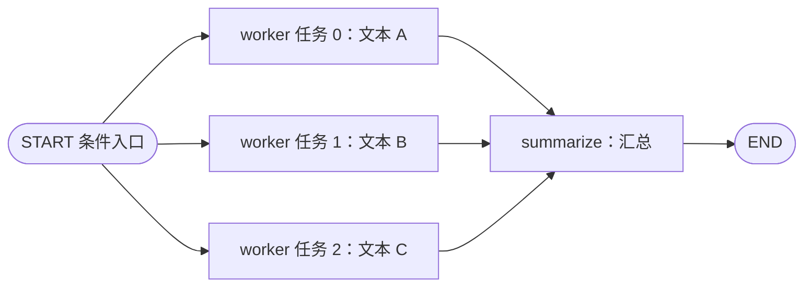

# 第八课：Send 动态分发与汇总

配套代码：[send_map_reduce_demo.py](../send_map_reduce_demo.py)。本课把多段文本交给同一个 worker 节点分别计数，再汇总结果；不调用模型或外部服务。

## 1. 从固定分支走向动态任务

第五课提前定义了 sum、maximum 两个不同节点。本课只注册一个 worker 节点，但每次输入的文本数量不同，需要执行的工作任务数量也不同。

| 输入 | worker 任务数量 | 图是否需要重新构建？ |
| --- | --- | --- |
| 三段文本  | 3 | 不需要 |
| 两段文本 | 2 | 不需要 |
| 空列表 | 0 | 不需要，走显式的空输入分支 |

**节点定义只有一个，运行时可以派生多个任务，各自带不同输入。** 这是 Send 在本例中的作用。[依据：Graph API 的 Send 说明](https://docs.langchain.com/oss/python/langgraph/graph-api#send)



图中的三个 worker 方框表示运行时任务，不是注册了三个不同节点。

## 2. Send 的两个参数

```python
Send("worker", {"index": 0, "text": "Learn LangGraph"})
```

- 第一个参数：目标节点名，本例为 worker。
- 第二个参数：这一个任务将收到的输入。

与仅返回目标节点名相比，Send 可以为每个任务提供不同的数据。构造 Send 对象是在描述派发任务；真正调用节点由运行时负责。

本课的路由函数：

```python
def dispatch(state):
    if not state["texts"]:
        return "summarize"
    return [
        Send("worker", {"index": index, "text": text})
        for index, text in enumerate(state["texts"])
    ]
```

它根据运行时的 texts 列表生成任务，而不是在构图时固定工作数量。[依据：官方 map-reduce 示例](https://docs.langchain.com/oss/python/langgraph/use-graph-api)

## 3. 整体 State 与单个任务的输入

整体状态保存批次数据：

```python
class BatchState(TypedDict):
    texts: list[str]
    results: Annotated[list[TextResult], add]
    report: str
```

工作任务的输入则只有：

```python
class WorkerInput(TypedDict):
    index: int
    text: str
```

本次运行日志确认，每个 worker 收到的输入字段是 index 和 text，没有整批 texts。它随后将自己的结果提交到整体状态已声明的 results 字段：

```python
return {"results": [{
    "index": state["index"],
    "text": state["text"],
    "word_count": len(state["text"].split()),
}]}
```

这体现了“任务输入”和“向图提交的状态更新”可以承担不同职责：每个任务只处理一项数据，输出由整体 State 的规则合并。

## 4. 怎样连接图？

```python
builder.add_node("worker", worker)
builder.add_node("summarize", summarize)
builder.add_conditional_edges(START, dispatch, ["worker", "summarize"])
builder.add_edge("worker", "summarize")
builder.add_edge("summarize", END)
```

这里直接在 START 上使用条件入口，没有额外增加分发节点。

本例每个 worker 只执行一步，这些任务属于同一轮并发工作；其更新合并后，summarize 在后续轮次运行一次。若以后把任务改成分支长度不同、需要循环的流程，应重新检查汇合时机，不要将本例的结构推广为所有复杂任务的完成条件。

## 5. 谁负责合并，谁负责业务汇总？

两部分各有职责：

| 部分 | 本课作用 |
| --- | --- |
| results 字段的 add reducer | 将每个任务返回的小列表合并为结果列表 |
| summarize 节点 | 遍历已合并的结果，计算总词数、生成报告 |

配置 reducer 不会自动替你完成业务上的求和、排序或选择最佳答案；这些逻辑仍由节点实现。

worker 返回的是新增的一条结果。summarize 排序后只更新 report，没有把完整结果列表再次返回到累加字段，避免重复累积。

每条结果带输入序号 index，展示时显式排序；不要根据工作任务日志的先后来认定最终列表顺序。

## 6. 两个容易遗漏的输入情况

**重复文本。** `['same text', 'same text']` 代表两个输入项。用 index 标识后，结果有两条，总词数为 4；没有将文本内容直接当作唯一任务标识。

**空批次。** 没有 worker 任务时，也就不能依靠 worker 的后续边触发汇总。本例显式路由到 summarize，生成“已处理 0 段文本，总词数=0”的报告。

任务数量动态变化时，应先定义这些边界情况，再决定状态结构和路由。

## 7. 运行结果

```powershell
python -B -X utf8 send_map_reduce_demo.py
```

| 场景 | worker 调用次数 | 汇总次数 | 总词数 |
| --- | --- | --- | --- |
| 三段文本 | 3 | 1 | 8 |
| 两段相同文本 | 2 | 1 | 4 |
| 空列表 | 0 | 1 | 0 |

验证记录：2026-10-22，三组实验均已在当前环境运行，结果与上表一致。复用同一张编译后的图，没有配置 Checkpointer，每次调用输入中的 results 都初始化为空列表。

本例按空白分隔词语，并非中文分词或模型 token 统计；它也不以日志顺序或运行耗时证明性能收益。Send 表达工作派发，实际并发度还受运行配置和执行资源影响。

## 8. 与已有知识连接

- 第五课：固定节点分支与结果合并。本课将任务数量和任务输入改为运行时确定。
- 第六课：worker 也可以封装更完整的处理流程，但仍需要明确输入输出接口。
- 第七课：每项工作可能失败，任务拆分后还要考虑重试、恢复和结果去重。

worker 可以是普通 Python 函数，也可以在内部调用模型、LangChain 组件或检索工具；Send 的任务派发机制保持一致。

## 9. 练习与下一课

1. 加入第四段文本，观察是否需要改动 build_graph。
2. 加入一个空字符串，区分“一个内容为空的任务”和“没有任务”。
3. 去掉 results 字段的 add，预测多项输入时会发生什么。

接着阅读[第九课：Command 状态更新与路由](./09_Command状态更新与路由.md)：在节点中同时提交状态更新、决定下一步。它与第三课用过的 Command(resume=...) 属于同一个类型的不同用法。
