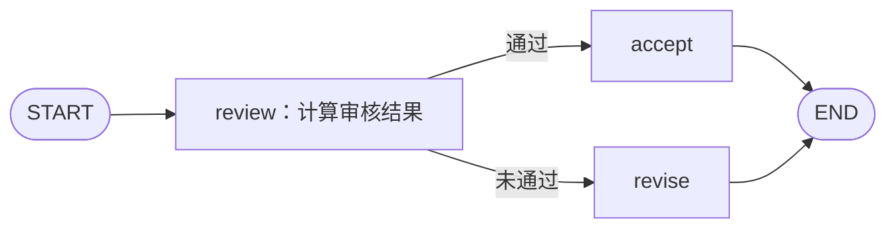

# 第九课：Command 状态更新与路由

配套实验：[command_routing_demo.py](../command_routing_demo.py)。本课用评分判断流程，对照“节点返回字典＋条件边”和“节点返回 Command”两种组织方式。

## 1. 要解决什么问题？

一个审核节点计算出 approved 后，还需要决定下一步：评分达到 80 则 accept，否则 revise。



流程保持一致，但状态更新与路由决策可以放在不同位置。

## 2. 熟悉的写法：返回字典，再由条件边路由

```python
def review(state):
    return {
        "approved": state["score"] >= 80,
        "status": "reviewed",
    }

def route(state):
    return "accept" if state["approved"] else "revise"

builder.add_conditional_edges("review", route)
```

review 返回状态更新，运行时应用更新后，条件边根据更新后的状态选择目标。

这种写法把处理与路由分开，适合明确展示独立的路由逻辑。

## 3. Command：在节点返回值里同时表达两件事

```python
from typing import Literal
from langgraph.types import Command

def review(state) -> Command[Literal["accept", "revise"]]:
    approved = state["score"] >= 80
    return Command(
        update={"approved": approved, "status": "reviewed"},
        goto="accept" if approved else "revise",
    )
```

| 参数 | 作用 |
| --- | --- |
| update | 提交本次 State 更新 |
| goto | 指定下一步调度的目标 |

本课 Command 版本没有再为 review 添加条件边；状态更新与下一目标由它的返回值共同表达。[依据：官方 Command 示例](https://docs.langchain.com/oss/python/langgraph/use-graph-api)

goto 表达运行时的后续调度，不会在当前函数里立即调用 accept。目标节点在后续执行时，能够读取已应用的 update。本次实验中 accept 日志显示 approved=True、status=reviewed。

## 4. 返回类型标注有什么用？

```python
-> Command[Literal["accept", "revise"]]
```

这表示该节点可能导航到 accept 或 revise，帮助 LangGraph 描述和渲染动态路径。目标节点仍需通过 add_node 注册；类型标注不会自动创建节点，也不替代业务条件检查。[依据：Graph API 的 Command 返回类型说明](https://docs.langchain.com/oss/python/langgraph/graph-api#command)

## 5. update 仍然遵循 reducer 规则

完整示例还维护一个 events 字段：

```python
events: Annotated[list[str], add]
```

review 提交 `"events": ["review"]`，accept 提交 `["accept"]`，最终得到：

```text
['review', 'accept']
```

Command.update 仍然是状态更新，不会绕过字段的合并规则。所以累加字段也应返回本次增量，避免重复提交完整历史。

## 6. 重要实验：goto 不会取消普通边

假设 review 返回：

```python
Command(update={"approved": True}, goto="accept")
```

同时图上还有：

```python
builder.add_edge("review", "static_notice")
```

那么 accept 和 static_notice 都会被调度。本课的第五组实验确实记录到了两个节点的事件。[依据：官方静态边与 Command 的关系](https://docs.langchain.com/oss/python/langgraph/graph-api#command)

因此，使用 Command 决定 review 的后续目标时，要检查是否还遗留其他普通边或路由。若期望单一路径，就应让控制方式与这个意图一致。

实验中的 static_notice 只更新配置了 add 的 events，不覆盖 status，避免与 accept 在同一步写入默认替换字段而产生并发冲突。这也连接了第五课的知识。

## 7. 和 Send、resume、普通字典对照

| 方式 | 常见使用位置 | 本课程中的用途 |
| --- | --- | --- |
| `return {...}` | 节点内部 | 提交状态更新；后续路径由图的边决定 |
| 条件边返回目标名 | 路由函数 | 根据状态决定目标，不提交普通 State 更新 |
| `return Command(update=..., goto=...)` | 节点内部 | 同时提交状态更新并指定后续目标 |
| `Send("worker", task_input)` | 第八课的路由函数 | 为任务指定目标及独立输入，支持动态分发 |
| `Command(resume=value)` | 调用方再次 invoke | 将外部回复交给等待中的 interrupt |

这些是常见用法的对照，不是说 Command 和 Send 只能各自独立使用；更复杂的控制结构可以组合它们。

本节的 update/goto 与第三课的 resume，使用同一个 Command 类型，但所处位置和用途不同。

当一个会话已经完成一轮，需要提交新用户输入时，通常仍向 invoke 传普通输入字典。不要用 `graph.invoke(Command(update=...), config)` 替代新一轮输入；本课的 update/goto 通过节点返回值交给运行时。[依据：官方 Command 调用上下文说明](https://docs.langchain.com/oss/python/langgraph/graph-api#command)

## 8. 什么时候选哪种写法？

- 只需要固定顺序：普通边即可。
- 只需要根据状态选路：条件边容易表达。
- 一次处理既产生状态更新，又自然地决定下一步：可以考虑 Command。
- 要为每个任务构造不同输入、数量运行时决定：可以考虑 Send。

选择取决于控制逻辑放在哪里更清楚，不需要为了使用新 API 而改写所有旧节点。

与 LangChain 简短对照：高层 Agent 封装了常见循环，直接构建 LangGraph 时，可以用这些控制原语安排流程。无论节点内部使用普通 Python 还是 LangChain 组件，节点仍需遵守图的状态和调度接口。

## 9. 运行与验证结果

```powershell
python -B -X utf8 command_routing_demo.py
```

| 场景 | 字典＋条件边 | Command |
| --- | --- | --- |
| score=90 | accepted，事件为 review、accept | 相同 |
| score=50 | needs_revision，事件为 review、revise | 相同 |
| score=90，Command 版本额外添加普通边 | 本组不运行 | accept 与 static_notice 都执行 |

验证记录：2026-10-23，以上五组调用已在当前环境运行通过。下游节点均读到 review 提交后的 approved 和 status；额外普通边实验记录到了 static_notice 事件。

本课不调用模型、不使用 Checkpointer；评分是本地输入，便于只观察状态更新与控制流。

## 10. 小练习与下一课

1. 把评分改为 80，预测两种实现是否都会进入 accept。
2. 在 Command 的 update 中加入一个新字段，先在 State 中声明，再观察下游节点如何读取。
3. 将实验中额外的普通边删除，确认 static_notice 事件不再出现。

接着阅读[第十课：真实模型与结构化输出](./10_真实模型与结构化输出.md)：将规则或模拟决策替换为模型返回的结构化数据，再由程序检查数据并控制路由。示例支持本机 key.env 配置，已用 glm-5.3 完成真实验证；具体记录见第十课。
