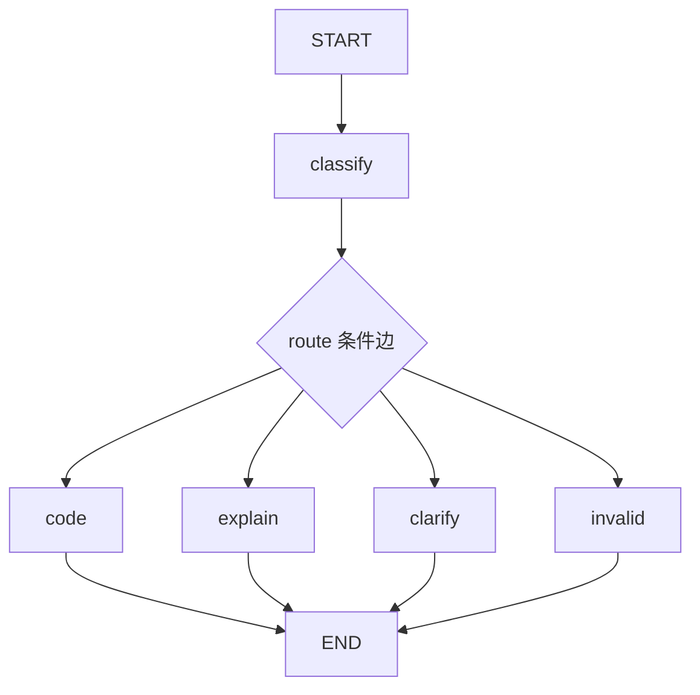

# 第十课：真实模型与结构化输出（精简版）

当前学习文件是 [structured_output_demo.py](../structured_output_demo.py)，共 164 行，按注释 1～9 顺序阅读。原版保存在 [structured_output_full.py](../structured_output_full.py)，原有的详细说明见[完整版参考](./10_真实模型与结构化输出_完整版参考.md)。

2026-10-26 验证：精简版的代码、讲解、澄清分支和 4 个无效输出场景已通过离线检查；使用 key.env 中的 glm-5.3 完成一次真实请求，最终状态为 code_selected。

## 1. 这份程序做什么

用户提出学习问题，模型将问题分类，程序检查返回数据，再由 LangGraph 选择分支。



route 是条件边调用的函数。每次运行从四个分支中选择一个。code 和 explain 当前只输出分支提示；clarify 输出澄清问题并结束，本课还没有暂停等待回复或生成完整答案。

## 2. 怎样运行

直接在 PyCharm 中运行 structured_output_demo.py，或在当前文件夹执行：

```powershell
python structured_output_demo.py
```

**精简版无需启动参数。请清空 PyCharm“脚本参数”中之前填写的 --live。** 直接运行会发出一次真实模型请求。

修改文件顶部这一行，就能更换本次问题：

```python
QUESTION = "请给我一个 LangGraph 条件边的最小代码示例。"
```

例如改成：

```python
QUESTION = "请解释 LangGraph 的 State。"
```

## 3. 模型配置放在哪里

只读取脚本旁的 key.env，使用下面三个字段：

```text
model: glm-5.3
api-key: 在本机填写你的密钥
base_url: https://discovery-api.intern-ai.org.cn/v1
```

也支持这三个字段用等号分隔、给值加成对引号。精简版不读取系统环境变量，不会再次受到旧 DEEPSEEK_API_KEY 的覆盖；key.env 已被 Git 忽略，密钥不打印到输出。

与原版相比，精简版仅保留当前平台需要的配置格式，不提供字段别名、命令行覆盖或 DeepSeek 官方扩展参数。

## 4. 按什么顺序读代码

| 代码部分 | 要理解的问题 |
| --- | --- |
| LearningRequest | 模型返回哪些字段？如何检查字段类型？ |
| RequestState | 整个图保存哪些数据？ |
| SYSTEM_PROMPT | 给模型的分类规则是什么？ |
| load_config | 怎样读取模型、密钥和接口地址？ |
| ask_model | 怎样把本次问题发给模型，拿回文本？ |
| classify | 怎样校验模型文本并更新 State？ |
| route | 怎样依据 State 返回下一站名称？ |
| code / explain / clarify / invalid | 选中的节点怎样更新结果？ |
| builder 与 graph.invoke | 怎样连接节点、启动图？ |

所有函数都定义在顶层，ask_model(question) 直接返回文本，不再先返回另一个函数。

## 5. 重点看三个动作

classify 中先调用模型：

```python
raw = ask_model(state["question"])
```

再用 Pydantic 解析并校验 JSON：

```python
decision = LearningRequest.model_validate_json(raw)
```

最后把校验通过的对象转成普通字典，作为状态更新交给图：

```python
return {"decision": decision.model_dump(), "status": "classified"}
```

模型数据不合格时，classify 将 status 设为 invalid_output，route 选择 invalid。网络或平台错误由入口处捕获，不归为模型内容校验失败。

route 使用普通 if 判断选择下一站；建图时用 add_conditional_edges 把返回的名称映射到节点。

## 6. example 是格式示范

SYSTEM_PROMPT 中的 JSON 示例会随分类规则发送给模型。本次需要分析的内容来自 QUESTION，通过 user 消息单独发送。

示例里的 topic 并不是本次输出的固定值，模型应根据 QUESTION 填写结果。

JSON 语法合法、字段校验合格、语义分类正确是三个不同层次。客户端校验能检查类型和显式约束，语义是否符合用户意图仍需要观察实际样本。

## 7. 原版留作以后参考

原版保留较完整的配置处理、错误分类和离线实验，运行方式为：

```powershell
python structured_output_full.py --check
python structured_output_full.py --live
```

当前优先理解精简版的数据流。后续学习到工程化配置、测试和异常处理时，再对照原版逐项补回。

## 8. 用“三层护甲”理解保护边界

可以将本例的防护设计记成：请求与响应检查 → 模型内容校验 → 校验失败的分支处理。更核心的设计是：将模型输出转成经过验证的 State，再由确定的程序逻辑选择节点。

| 层次 | 保护什么 | 当前精简版对应位置 |
| --- | --- | --- |
| 请求与响应检查 | 配置字段缺失、HTTP 错误、响应格式异常、未按预期结束 | load_config、ask_model、入口的异常处理 |
| 模型内容校验 | JSON 语法、字段类型、枚举、长度和明确的跨字段约束 | LearningRequest 和 classify 中的 if 判断 |
| 校验失败的分支处理 | 使未通过内容校验的数据不进入正常业务节点 | classify 写入 invalid_output，route 选择 invalid |

几个边界需要记清楚：

1. 第一层描述的是职责，不代表发生在进图之前。精简版的调用顺序是 graph.invoke → classify → ask_model → load_config；网络请求发生在 classify 执行期间，异常传到入口处处理。原版有一部分配置检查在 invoke 之前，但网络请求同样在图节点内。
2. URL 的 HTTPS 和模型名称检查存在于原版，精简版只检查三个配置字段非空。HTTPS 协议格式检查也不能证明目标服务可信或密钥有效。
3. HTTP 401 表示本次认证失败，还可能涉及失效密钥、平台不匹配或配置被覆盖；不能直接断定是手工填错。HTTP 429 需结合该平台错误正文判断，不能直接等同余额不足。本项目对照记录中，具体返回的是 DeepSeek 模型通道限流，同一密钥下 GLM 成功。
4. finish_reason 不为 stop 不一定都是截断；本例只接受 stop，其余情况停止处理。这里跳过的是模型正文的进一步解析校验，平台响应外层已通过 response.json() 读取。
5. 原版用 model_validator 检查跨字段约束；精简版改成 classify 中的普通 if，内容校验失败时捕获 ValidationError 或 ValueError。
6. Pydantic 校验通过，只说明数据符合已写出的结构和规则。用户要代码，模型却选择 explanation，也可能通过全部校验；这属于语义分类错误，需要真实样本、评估或额外业务规则发现。
7. invalid 只处理本例预期的内容校验失败。401、超时、响应协议异常会向外传播；其他节点发生程序错误也不保证进入 invalid。兜底分支使这类校验失败受控结束，不会自动修复输出、重试或恢复执行。

例如这两种失败会走不同路径：

```text
模型正文是无效 JSON → classify 捕获校验错误 → invalid_output → invalid → END
请求返回 HTTP 401 → ask_model 抛出 HTTPStatusError → 入口捕获并提示 → 本次退出
```

提示词负责提出要求，Pydantic 和普通 Python 判断负责校验，LangGraph 负责执行节点和根据 State 路由。RequestState 的 TypedDict 主要描述状态结构，本例对外部模型输出的运行时校验由 LearningRequest 完成。

参考：[Pydantic 严格模式](https://docs.pydantic.dev/latest/concepts/strict_mode/)、[HTTPX 异常分类](https://www.python-httpx.org/quickstart/#exceptions)。
