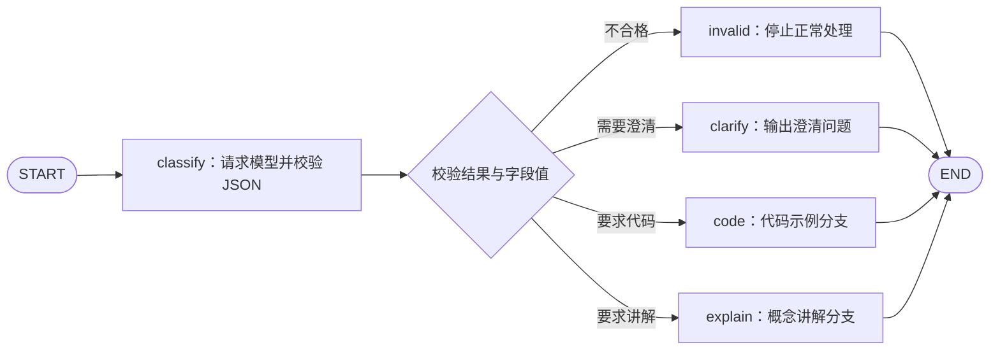

# 第十课：真实模型与结构化输出（完整版参考）

当前主线已改用[精简版](./10_真实模型与结构化输出.md)。本文保留原版的配置选项和实验说明，供之后参考。

本课通过用户提供的 Intern InkStone 兼容平台调用模型，已用 glm-5.3 完成真实验证，并记录 DeepSeek 的对照结果。配套代码：[structured_output_full.py](../structured_output_full.py)。

验证状态：2026-10-23，6 个 schema/路由样本与 2 个模拟 HTTP 场景已运行通过。使用 key.env 中的同一密钥和同一平台地址，glm-5.3 已完成“真实模型输出 → Pydantic 校验 → LangGraph 条件路由”，最终状态为 code_selected。

| 对照请求 | 实测结果 |
| --- | --- |
| deepseek-v4.1-flash-1017，完整分类请求 | HTTP 429，rate_limit_exceeded，Channel rate limit reached for model |
| 同一 DeepSeek 模型，去掉 JSON mode、temperature 和 system 提示词的极简请求 | 同样返回模型通道 HTTP 429 |
| glm-5.3，完整分类请求 | 成功返回合格 JSON，进入 code 分支 |

这些结果将问题缩小到该 DeepSeek 模型的调用路径，不能据此说整个 API、密钥或账号都不可用。平台为什么限制此模型通道，仍需平台侧信息才能确定。代码支持用 --model 临时切换模型，不改写 key.env 中已有的模型名称。

## 1. 真实模型放在图的什么位置？

前面的示例用规则或预设数据产生决策。这节在 classify 节点里调用真实模型，请它把学习请求分类成结构化数据，然后校验并路由：



本课模型只分类请求，不生成完整教学答案。code 与 explain 节点目前返回分支提示，便于验证模型数据怎样驱动图；它们不是完整的代码生成或知识问答功能。

## 2. 先定义程序期望的数据

核心 schema：

```python
class LearningRequest(BaseModel):
    model_config = ConfigDict(strict=True, extra="forbid")
    topic: str = Field(min_length=1, max_length=80)
    output_format: Literal["explanation", "code"]
    needs_clarification: bool
    clarifying_question: str = Field(max_length=160)
```

含义分别是：学习主题、期望输出形式、是否缺少关键信息，以及需要追问的问题。

这里使用 Pydantic，而不是只写 TypedDict：

- 字段类型、枚举、长度等会在运行时校验。
- strict=True 避免将字符串 `"false"` 自动当作布尔值 False。
- extra="forbid" 拒绝未定义的额外字段。

完整代码还用 model_validator 检查字段之间的约束：需要澄清时问题必须非空，无需澄清时该字段必须为空；topic 也不能只有空白。[依据：Pydantic 严格模式](https://docs.pydantic.dev/latest/concepts/strict_mode/)

## 3. JSON 格式、schema、语义是三个层次

| 层次 | 检查什么 | 例子 |
| --- | --- | --- |
| JSON 语法 | 字符串能否作为 JSON 解析 | 花括号、引号、逗号是否完整 |
| schema 与显式业务约束 | 字段是否存在、类型是否正确、约束是否成立 | needs_clarification 必须是布尔值 |
| 语义与事实质量 | 分类是否符合用户意图、主题是否识别正确 | 用户要代码，模型却选择讲解 |

即使通过 schema，模型仍可能分类错误。程序能检查的确定规则，应显式实现；语义质量还需要用真实样本评估。

## 4. 怎样要求模型返回 JSON？

本例使用现有 httpx 请求 Chat Completions 接口，避免为这一课改变项目依赖环境。官方与第三方平台通过 base_url 选择。请求中的通用部分是：

```python
{
    "messages": [
        {"role": "system", "content": system_prompt()},
        {"role": "user", "content": question},
    ],
    "response_format": {"type": "json_object"},
    "max_tokens": 1024,
}
```

system_prompt 中明确要求只输出 JSON，提供一个示例，并加入 `LearningRequest.model_json_schema()` 生成的 schema。DeepSeek 的 JSON Output 文档要求在提示词中指导 JSON 格式，并提醒截断、空正文等情况需要处理。[依据：DeepSeek JSON Output](https://api-docs.deepseek.com/guides/json_mode/)

这个 Chat Completions 请求要求 JSON mode，不等同于服务端严格执行我们的完整 schema；客户端仍需校验。第三方平台的 glm-5.3 已实际接受此请求并返回合格 JSON，这不代表所有模型都支持相同参数。只有使用 DeepSeek 官方域名时，示例额外发送 `thinking={"type": "disabled"}`；第三方接口先使用通用参数，不假定其支持同样的扩展字段。

截至本课查阅日期，官方 JSON Output 示例使用 deepseek-flash，本代码以它为未配置时的默认模型。实际运行优先采用 --model，其次是 key.env 的模型名称，再其次是 DEEPSEEK_MODEL 环境变量。不要直接假定旧 demo 的模型名称和参数能力在任何时候都相同。[依据：DeepSeek Chat Completions](https://api-docs.deepseek.com/api/create-chat-completion/)

请求只发送本次 question 和本课的分类提示词，不自动读取或发送工作区文档。

## 5. 校验完成后，才写入正常决策数据

classify 节点中的关键逻辑：

```python
raw = generate_json(state["question"])
decision = LearningRequest.model_validate_json(raw)
return {
    "raw_json": raw,
    "decision": decision.model_dump(),
    "status": "classified",
}
```

完整代码捕获 ValidationError，将错误写入 validation_errors，并置 status 为 invalid_output。条件边优先检查这个状态，错误输出不会进入正常的 code/explain/clarify 分支。

通过校验的数据存为普通字典，后续节点依据字段路由：

```python
if state["status"] == "invalid_output":
    return "invalid"
if state["decision"]["needs_clarification"]:
    return "clarify"
return "code" if state["decision"]["output_format"] == "code" else "explain"
```

模型提供结构化判断，程序执行明确的校验和控制逻辑；模型服务本身不负责运行这些图节点。

## 6. 两种运行模式

先运行不联网的校验实验：

```powershell
python -B -X utf8 structured_output_full.py --check
```

| 预设输出场景 | 实际状态 |
| --- | --- |
| 概念请求 | explanation_selected |
| 代码请求 | code_selected |
| 需要澄清且有问题 | needs_clarification |
| 布尔字段写成字符串 | invalid_output |
| 需要澄清却没有问题 | invalid_output |
| JSON 被截断 | invalid_output |

另外两个场景用 httpx.MockTransport 验证官方与第三方接口的请求构造和响应解析，包括 /v1 路径拼接与扩展参数的区别，但响应依然是本地预设数据，不会访问模型服务。

真实模型调用默认读取脚本旁的 key.env，兼容当前文件使用的格式：

```text
model: 你的 DeepSeek 模型名称
api-key: 你的 API Key
base_url: https://discovery-api.intern-ai.org.cn/v1
```

这里是格式说明，示例文字需要替换为本机配置。也支持 `DEEPSEEK_MODEL=...` 和 `DEEPSEEK_API_KEY=...` 的写法；文件为 UTF-8，可给值加成对引号。此加载器只处理本课这几个配置字段，不执行文件内容，也不是完整的 dotenv 解析器。

按文件中模型名称运行一次真实请求：

```powershell
python -B -X utf8 structured_output_full.py --live
```

当前已验证成功的模型是 glm-5.3，复现本课结果可临时覆盖模型：

```powershell
python -B -X utf8 structured_output_full.py --live --model glm-5.3
```

真实返回的 decision 为：

```json
{"topic": "LangGraph 条件边", "output_format": "code", "needs_clarification": false, "clarifying_question": ""}
```

Pydantic 校验通过后，条件边读取 output_format=code，最终状态为 code_selected。图只返回进入代码分支的提示，本课尚未在该分支生成完整代码答案。

根目录 .gitignore 已忽略 key.env。程序不打印 Key；只将它用于所配置平台的身份认证，不放入模型提示词。key.env 中的非空密钥优先，文件未填写时才使用环境变量 DEEPSEEK_API_KEY；也可在自己的交互式终端使用 --prompt-key 隐藏输入，其优先级最高。--env-file 可指定其他配置文件路径。

接口地址优先级为 --base-url、key.env 的 base_url、DEEPSEEK_BASE_URL 环境变量，均未配置才使用 DeepSeek 官方地址。程序在基础地址后添加 /chat/completions，因此这里应填写包含 /v1 的基础地址，不要重复填写完整请求路径。API Key 必须与平台对应；同一模型在不同平台也可能使用不同名称。当前平台公开页面给出了此 OpenAI 兼容基础地址及账户共享的 RPM/TPM 限额说明。[平台说明](https://discovery.intern-ai.org.cn/token-plan/home)

启动时必须提供 --check 或 --live。在 PyCharm 直接点击运行时，要在该脚本的运行配置中将“脚本参数”设为 --live；否则 argparse 会报告缺少运行模式，尚未发出模型请求。

程序会打印实际模型、平台域名和密钥来源，不打印密钥。如果出现 HTTP 401，先查看“密钥来源”是否为预期的 key.env。此前用户运行日志显示读取了环境变量中的旧密钥，覆盖文件值后认证失败；现已将本课改为文件优先，防止编辑器遗留配置干扰。--prompt-key 仍使用本次手工输入。不同终端与编辑器进程的环境变量也可能不同。401 说明本次身份认证失败，单凭状态码不能判断是否读到了错误配置、密钥已失效或平台侧出现问题。

指定不同问题：

```powershell
python -B -X utf8 structured_output_full.py --live --model glm-5.3 --question "请解释 LangGraph 的 Checkpointer。"
```

当前环境已具备 langgraph 1.2.4、pydantic 2.13.4、httpx 0.28.1，无需为本课另装模型 SDK。其他环境缺少这些依赖时，应先在自己的项目环境中安装。

## 7. 不同失败应分开处理

| 失败位置 | 示例 | 本课处理 |
| --- | --- | --- |
| 请求发送或服务状态 | 连接失败、HTTP 401/其他错误 | 调用失败，给出状态或异常类型 |
| 服务响应协议 | 没有 choices、正文不是字符串、finish_reason 不为 stop | 拒绝作为正常模型结果继续 |
| 输出内容校验 | 无效 JSON、类型错误、跨字段约束不满足 | 进入 invalid 分支 |
| 语义判断质量 | 数据结构正确，但识别错用户意图 | 通过真实样本检查；schema 本身无法完全识别 |

本课每次 --live 发起一次模型请求，不额外自动重试。若后续结合第七课，要分别设计网络错误重试与模型输出修正循环，避免将所有错误原样重做。

clarify 分支当前只返回澄清问题并结束。这与第三课 interrupt 的“暂停后等待回复”不同；以后可将它改为 interrupt，并配置 Checkpointer 延续上下文。

## 8. 与 LangChain 的结构化接口对照

对于支持相应能力的 LangChain 聊天模型，可以使用类似的封装：

```python
structured_model = model.with_structured_output(LearningRequest)
decision = structured_model.invoke(messages)
```

这段是接口示意，没有在本课环境安装或验证具体模型适配器。具体方法可能使用 JSON mode、工具调用或提供商原生 schema 能力，应按所选模型支持情况配置。[依据：LangChain 模型结构化输出](https://docs.langchain.com/oss/python/langchain/models#structured-output)

无论通过直接 HTTP 还是 LangChain 适配器取得结果，LangGraph 仍负责节点、State、边与执行流程。本课把这些职责分开，便于理解各层实际做了什么。

## 9. 练习与下一课

1. 用真实模式分别输入“解释 State”“给出条件边代码”“它为什么不运行”，检查分类是否符合预期。
2. 给 output_format 增加一种选择，并修改路由；思考只改提示词、却不改 schema 会发生什么。
3. 添加一个 schema 合法但分类错误的离线样本，体会格式校验与语义评估的区别。

下一课学习流式输出与调试：区分节点提交的更新、完整状态快照、模型输出片段及自定义进度。
